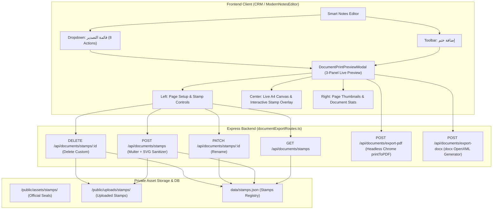

# ELFAZNI SERVICES — Professional Document Printing, PDF/DOCX Export & Custom Stamp System

## Executive Overview

This document describes the architectural implementation of the **Professional Document Printing, Vector PDF Export, Microsoft Word (DOCX) Export, and Custom Company Stamp Management System** integrated into the ELFAZNI SERVICES platform at `http://localhost:8080/`.

The system extends the **Smart Notebook / My Notes Editor** (`ModernNotesEditor.tsx`) to deliver enterprise-grade document creation, layout customization, certified stamping, and high-fidelity multi-format publishing while preserving corporate identity guidelines (Cobalt Blue `#004AA5`, Official Gold `#CC9048`, Deep Navy `#0B2E57`, and Bahij / Cairo Arabic typography).

---

## 1. System Architecture

---

## 2. Component Specifications

### 2.1 Upgraded Export Menu (`ModernNotesEditor.tsx`)
The existing **تصدير** (Export) dropdown menu has been upgraded from a basic fallback to a fully functional 8-option enterprise menu:
1. **حفظ بصيغة PDF — Export PDF**: Generates a vector PDF with the note's active layout and stamping preferences.
2. **حفظ بصيغة Word — Export DOCX**: Generates a native Microsoft Word (`.docx`) file with embedded tables and RTL bidirectional formatting.
3. **طباعة المستند — Print**: Triggers the browser native print dialog with clean `@media print` stylesheets.
4. **معاينة قبل الطباعة — Print Preview**: Opens the 3-panel live document preview modal focused on page layout.
5. **إعدادات الصفحة — Page Setup**: Opens the modal directly on the Page Setup tab.
6. **إضافة ختم — Add Stamp**: Opens the modal directly on the Stamp Manager tab.
7. **تصدير نسخة مختومة — Export Stamped PDF**: Forces immediate export of a stamped PDF document.
8. **تصدير نسخة بدون ختم — Export Clean PDF**: Forces export of a pristine clean PDF without the stamp layer.

### 2.2 Dedicated Toolbar Button: إضافة ختم
- Placed on the main editor toolbar featuring the `Stamp` icon from `lucide-react`.
- Displays an active green pulsing status indicator when the active note has an enabled stamp.
- One-click trigger opens the Stamp Manager tab in the live preview modal.

### 2.3 Professional Page Setup Panel
Supports all industry-standard document layout parameters:
- **Paper Sizes**: A4 (`210 × 297 mm`), A5 (`148 × 210 mm`), Letter (`216 × 279 mm`), Legal (`216 × 356 mm`), and Custom dimensions (with numeric mm inputs for width and height).
- **Orientation**: Portrait (عمودي) and Landscape (أفقي) with visual aspect ratio toggles.
- **Margins**: Presets for Normal (`15 mm`), Narrow (`10 mm`), Wide (`25 mm`), and Custom individual numeric inputs for Top, Bottom, Right, and Left margins.
- **Header & Footer Controls**:
  - Independent enable/disable toggles.
  - Custom header text, document title toggle, and dynamic date stamp.
  - Custom footer text, page numbering (`صفحة X من Y`), and date stamp.
- **Background Printing**: Toggle to preserve table header colors (`#004AA5`), card accents, and status badges.
- **RTL Typography**: Strict Arabic right-to-left alignment, justification, and font stack hierarchy.

---

## 3. Custom Company Stamp System

### 3.1 Default Official Company Stamps
The system comes seeded with three high-resolution official company seals:
1. **الختم الرسمي لمجموعة الفزني (أزرق ملكي)**: Circular seal in royal cobalt blue (`#004AA5`) with Moroccan star, official emblem, and dual Arabic/French wordmarks.
2. **خاتم التوثيق والمصادقة (ذهبي وكحلي)**: Official certification and apostille seal in gold (`#CC9048`) and navy (`#0B2E57`).
3. **خاتم سري وخاص للغاية (أحمر تنفيذي)**: Rectangular executive confidentiality stamp in crimson red (`#DC2626`).

### 3.2 Private Asset Library & Security
- **File Validation**: Accepts transparent PNG, WebP, and clean vector SVG up to 10 MB.
- **SVG Sanitization**: All uploaded SVG files are passed through `sanitizeSvgContent()` to strip embedded `<script>` tags, dangerous event attributes (`onload`, `onerror`), and foreign namespaces, protecting against XSS vulnerabilities.
- **System Seal Protection**: Seeded official seals (`stamp_official_blue`, `stamp_certified_gold`, `stamp_confidential_red`) are protected from accidental deletion.

### 3.3 Interactive Canvas Positioning & Controls
- **Interactive Dragging**: The administrator can click and drag the stamp anywhere across the A4 sheet canvas in real time. Coordinates (`xPercent`, `yPercent`) update continuously.
- **Corner Resize Handles**: 4 corner handles allow interactive scaling from `10%` to `400%`.
- **Rotation Handle**: Top stalk handle allows interactive angle adjustments from `-180°` to `+180°`.
- **Opacity Slider**: Configurable from `10%` to `100%`.
- **Layer Toggle**: Switch between **Foreground Stamp** (overlaying document text) and **Background Watermark** (placed behind text).
- **Position Presets**: One-click placement to Bottom Right (معتمد), Bottom Left, Bottom Center, Top Right, Top Left, or Center.
- **Position Lock**: Prevent accidental repositioning once approved.

---

## 4. Headless Chrome & OpenXML Document Engines

### 4.1 Real Vector PDF Engine (`/api/documents/export-pdf`)
- Powered by Puppeteer headless Chrome (`page.pdf()`).
- Injects a self-contained HTML template with `@page` CSS rules, embedded fonts (Bahij TheSansArabic, Cairo, Tajawal, Inter), and strict RTL paragraph direction.
- Real-time stamp overlay injection at computed percentage coordinates.
- Generates uncompressed, high-fidelity vector PDF files.

### 4.2 Real Microsoft Word Engine (`/api/documents/export-docx`)
- Powered by the `docx` library.
- Generates genuine OpenXML `.docx` files with `<w:bidi/>` flags on every paragraph for native Arabic rendering in Microsoft Word.
- Converts HTML headings (`H1`-`H6`), bulleted and numbered lists, and styled data tables into native Word OpenXML elements.
- Embeds company stamp image assets anchored directly within the Word document.

---

## 5. Persistence & State Synchronization

- Document setup (`pageSetup`) and stamp configuration (`stampConfig`) are declared as first-class fields on `NoteItem` in `productivityService.ts`.
- Auto-save debouncing persists changes to local storage and the server-backed productivity database immediately upon user confirmation.
- Reloading the page or switching notes restores all customized margins, paper dimensions, and stamp settings.
