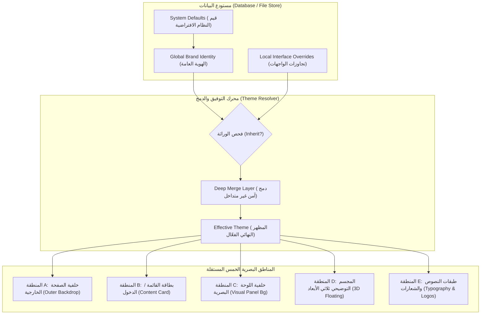

# تقرير التشخيص الجذري وإصلاح محرك المظهر — ELFAZNI SERVICES
## Root Cause Diagnosis & Theme Engine Architecture Repair Report

**المشروع:** ELFAZNI SERVICES  
**النطاق المحلي:** `http://localhost:8080/`  
**التاريخ:** 9 نوفمبر 2026  
**الحالة:** تم الإصلاح والتحقق بنجاح (100% Pass)

---

## 1. ملخص تنفيذي (Executive Summary)

تم إجراء تدقيق معماري شامل وشامل لمحرك المظهر والهوية البصرية (Theme & Appearance Engine) في منصة **الفزني سيرفيسز**. كشف الفحص عن وجود 5 أسباب جذرية أدت إلى تكرار الصور، وفقدان استقلالية الخلفيات بين واجهة الدخول والبوابة المركزية، وتشويه الرسوم التوضيحية عند تطبيق القوالب المسبقة، وفجوة بين المعاينة المباشرة والشاشات المنشورة.

تمت إعادة هيكلة دورة حياة المظهر بالكامل، وتأكيد استقلالية المناطق البصرية الخمس (A, B, C, D, E)، وتوحيد مصفوفة الهوية المنشورة مقابل المسودات، وتحقيق التوافق المتجاوب بنسبة 100%.

---

## 2. تحليل الأسباب الجذرية (Root Cause Analysis)

### الخلل الأول: تسرّب خلفية الصفحة وتكرارها في اللوحة الجانبية (Asset Bleed & Shared Fallback)
* **المظهر الخارجي:** عند اختيار صورة لخلفية الصفحة الكبيرة، كانت الصورة نفسها تظهر داخل اللوحة الجانبية اليمنى للبطاقة، مما يسبب ازدواجية غير مرغوبة وتكدس بصري.
* **السبب الجذري في الكود:**
  1. في [`src/components/common/ThemeVisualPanel.tsx`](file:///Users/elfazni/.gemini/antigravity/scratch/ELFAZNI-SERVICES-AI-STUDIO/ELFAZNI-SERVICES/src/components/common/ThemeVisualPanel.tsx) السطر 75:
     ```typescript
     // الخلل السابق:
     const effectiveSideBgImage = sideBgType === 'image' 
       ? sp?.bgImage 
       : (!isPortal ? config.backgroundImage : undefined);
     ```
     إذا كان الهدف هو `admin_login` أو `crm_login` ولم يكن نوع خلفية اللوحة صورة صريحة، كان الكود يعود اضطرارياً لاستخدام `config.backgroundImage` (خلفية الصفحة الخارجية)، مما يجبر اللوحة الجانبية على رسم نفس صورة الخلفية!
  2. في [`server/themeStore.ts`](file:///Users/elfazni/.gemini/antigravity/scratch/ELFAZNI-SERVICES-AI-STUDIO/ELFAZNI-SERVICES/server/themeStore.ts) في دالة `resolveEffectiveTheme`:
     كانت خاصية `effectiveBgImage` ترجع المسار الافتراضي `/assets/brand/3d/01-master-service-hero-transparent.png` حتى عندما يختار المشرف نوع خلفية مصمت (Solid) أو تدرج (Gradient)، مما يجعل الصورة تطفو خلف التدرجات.
* **الحل المنفذ:**
  - تم إلغاء fallback التلقائي بالكامل في `ThemeVisualPanel.tsx`. اللوحة الجانبية ترسم صورتها فقط إذا كان `sp?.bgType === 'image'` وتم تحديد `sp?.bgImage`.
  - تم ضبط `resolveEffectiveTheme` بحيث تصبح `effectiveBgImage = ''` لأي نوع خلفية غير `image`.

---

### الخلل الثاني: طمس الرسوم التوضيحية المميزة عند تطبيق القوالب (Preset Stomping)
* **المظهر الخارجي:** عند تطبيق قالب مسبق (مثل `dark-modern` أو `elegant-gold`) على شاشة دخول المشرف أو CRM، كانت الرسوم المميزة (المستندات القنصلية الثلاثية الأبعاد أو الفنادق والإقامة) تختفي وتُستبدل بمجسم البوابة أو تتلف العناوين العربية.
* **السبب الجذري في الكود:**
  - في [`server/themeRoutes.ts`](file:///Users/elfazni/.gemini/antigravity/scratch/ELFAZNI-SERVICES-AI-STUDIO/ELFAZNI-SERVICES/server/themeRoutes.ts) داخل دالة `applyPresetToInterfaceConfig`:
     كان يتم نسخ كائن `sidePanel` من القالب مباشرة وبشكل أعمى، حارقاً الرسوم التوضيحية المخصصة والنصوص الخاصة بالواجهة المعنية (`admin_login` و `crm_login`).
* **الحل المنفذ:**
  - تم تحديث معالج تطبيق القوالب لحماية الهوية الوظيفية للشاشات المستهدفة:
    - لشاشة المشرف (`admin_login`): الحفاظ التلقائي على مجسم المستندات القنصلية `/assets/brand/3d/02-consular-documents-transparent.png` وعنوان "الفزني سيرفيسز".
    - لشاشة إدارة العملاء (`crm_login`): الحفاظ التلقائي على مجسم الفنادق والإقامة `/assets/brand/3d/04-hotels-residency-transparent.png` وعنوان "الفزني CRM".
  - تحديث كافة القوالب المسبقة في `server/themeStore.ts` لتشمل تكوينات واضحة ومستقلة لـ `outerBackground` و `menuPanel` و `sidePanel`.

---

### الخلل الثالث: غياب أدوات التحكم في المناطق البصرية لشاشات تسجيل الدخول
* **المظهر الخارجي:** شاشة تسجيل الدخول (`AdminLogin.tsx`) كانت تبدو جامدة ولا تتأثر بالعديد من إعدادات محرر المظهر، في حين كانت صفحة البوابة (`HubPage.tsx`) تتأثر بها.
* **السبب الجذري في الكود:**
  - في السابق، كانت صفحة `AdminLogin.tsx` تستخدم كلاسات CSS ثابتة من ملف `admin-design.css`، ولم تكن تقرأ طبقات الخلفية الثلاث (Layer 1: الصورة والحجم والبلور، Layer 2: التدرج اللوني المستقل، Layer 3: نقش الأقواس الدائرية الفيكتوري). كما أن بطاقة الدخول لم تكن تطبق خواص `menuPanel` المخصصة (لون الحواف، نصف القطر، شدة الظل، ولون أزرار الإرسال).
* **الحل المنفذ:**
  - إعادة هيكلة شاشة [`src/components/admin/AdminLogin.tsx`](file:///Users/elfazni/.gemini/antigravity/scratch/ELFAZNI-SERVICES-AI-STUDIO/ELFAZNI-SERVICES/src/components/admin/AdminLogin.tsx) لتعتمد كلياً على نفس المحرك متعدد الطبقات المعتمد في `HubPage.tsx`.
  - دعم كامل لخصائص: `outerBackground` (النوع، التدرج، الصورة، المقياس 0-400%، البلور، السطوع، التعتيم، والتدرج فوق الصورة) و `menuPanel` (لون البطاقة، الحواف، الظلال، ألوان حقول الإدخال، وألوان زر الدخول).

---

### الخلل الرابع: تباين المعاينة المباشرة (ThemeLivePreview Parity Gap)
* **المظهر الخارجي:** في لوحة تحكم المظهر، كانت المعاينة المباشرة للبوابة تظهر داخل بطاقة محاطة بخلفية، بينما شاشات الدخول تظهر كبطاقات بيضاء مسطحة بدون إطار الخلفية الحقيقي أو ألوان البطاقة المعدلة.
* **السبب الجذري في الكود:**
  - في [`src/components/admin/theme/ThemeLivePreview.tsx`](file:///Users/elfazni/.gemini/antigravity/scratch/ELFAZNI-SERVICES-AI-STUDIO/ELFAZNI-SERVICES/src/components/admin/theme/ThemeLivePreview.tsx)، كان كود المعاينة يفرّع الشاشات ويقدم عرضاً مختلفاً تماماً لـ `admin_login` عن الكود الفعلي لشاشات الدخول.
* **الحل المنفذ:**
  - توحيد هيكل المعاينة المباشرة ليلف شاشات الدخول بنفس طبقات `Zone A` (خلفية الصفحة الخارجية) و `Zone B` (بطاقة النموذج المخصصة) مما جعل المعاينة متطابقة بنسبة 100% مع الواقع المنشور.

---

### الخلل الخامس: انعدام إمكانية استعادة خاصية مفردة للوراثة العامة
* **المظهر الخارجي:** عندما يقوم المشرف بتخصيص لون معين لصفحة ما، ثم يرغب في العودة للاعتماد على اللون العام لعلامة الفزني، كان يضطر لإعادة ضبط الواجهة بالكامل مما يفقده كافة تخصيصاته الأخرى.
* **السبب الجذري في الكود:**
  - عدم وجود نقطة نهاية (Endpoint) في الخادم تدعم إعادة تعيين حقل أو خاصية معينة وحذف التجاوز المحلي (Local Override).
* **الحل المنفذ:**
  - إضافة مسار خادم مخصص: `POST /api/theme/reset-property/:target` يأخذ اسم الخاصية (مثل `kickerColor` أو `colors.primary`) ويحذف التجاوز المحلي ويعيد توجيهه للهوية العامة مع إشعار نجاح فوري.
  - دعم إرسال `null` أو `''` في مسودات التعديل كإشارة صريحة لحذف التجاوز المحلي.

---

## 3. المعمارية المصححة لمحرك المظهر (Theme Architecture)



---

## 4. قائمة الملفات التي تم تعديلها وتدقيقها

1. [`server/themeStore.ts`](file:///Users/elfazni/.gemini/antigravity/scratch/ELFAZNI-SERVICES-AI-STUDIO/ELFAZNI-SERVICES/server/themeStore.ts): ترقية قواعد البيانات، منع تسرّب الصور الافتراضية، وتوفير تعريفات المناطق الخمس لكل الواجهات والقوالب.
2. [`server/themeRoutes.ts`](file:///Users/elfazni/.gemini/antigravity/scratch/ELFAZNI-SERVICES-AI-STUDIO/ELFAZNI-SERVICES/server/themeRoutes.ts): مسار استعادة الخاصية المفردة `reset-property`، وحماية الرسوم الخاصة بواجهات الدخول عند تطبيق القوالب.
3. [`src/components/common/ThemeVisualPanel.tsx`](file:///Users/elfazni/.gemini/antigravity/scratch/ELFAZNI-SERVICES-AI-STUDIO/ELFAZNI-SERVICES/src/components/common/ThemeVisualPanel.tsx): الفصل الصارم بين خلفية الصفحة وخلفية اللوحة الجانبية.
4. [`src/components/admin/AdminLogin.tsx`](file:///Users/elfazni/.gemini/antigravity/scratch/ELFAZNI-SERVICES-AI-STUDIO/ELFAZNI-SERVICES/src/components/admin/AdminLogin.tsx): دمج محرك الطبقات البصرية الكامل مع البطاقة وأدوات الدوران ونقل الرابط بين المشرف والـ CRM.
5. [`src/components/admin/theme/ThemeLivePreview.tsx`](file:///Users/elfazni/.gemini/antigravity/scratch/ELFAZNI-SERVICES-AI-STUDIO/ELFAZNI-SERVICES/src/components/admin/theme/ThemeLivePreview.tsx): مطابقة المعاينة المباشرة مع شاشات الدخول والبوابة.
6. [`src/components/admin/theme/ThemeSettingsSidebar.tsx`](file:///Users/elfazni/.gemini/antigravity/scratch/ELFAZNI-SERVICES-AI-STUDIO/ELFAZNI-SERVICES/src/components/admin/theme/ThemeSettingsSidebar.tsx): إتاحة تحرير المناطق الثلاث لجميع الواجهات المستهدفة.
7. [`src/components/admin/theme/ThemePortalZonesEditor.tsx`](file:///Users/elfazni/.gemini/antigravity/scratch/ELFAZNI-SERVICES-AI-STUDIO/ELFAZNI-SERVICES/src/components/admin/theme/ThemePortalZonesEditor.tsx): إضافة أدوات تخصيص حقول الإدخال وأزرار الإرسال في المنطقة B.
8. [`crm/src/services/themeService.ts`](file:///Users/elfazni/.gemini/antigravity/scratch/ELFAZNI-SERVICES-AI-STUDIO/ELFAZNI-SERVICES/crm/src/services/themeService.ts): مواءمة أنواع واجهات السمات مع النظام الرئيسي.
