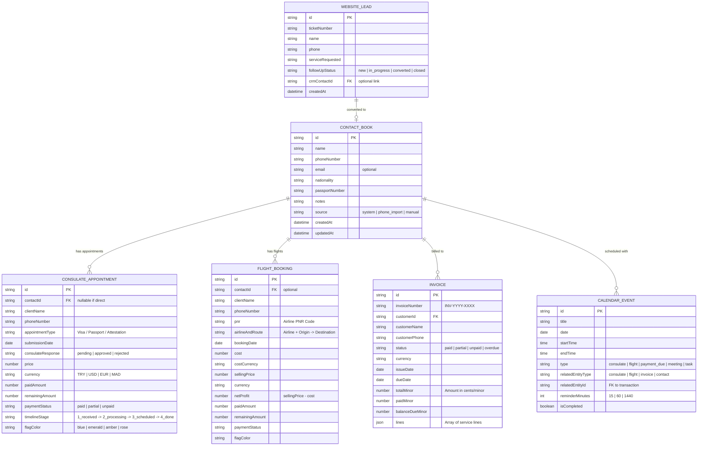
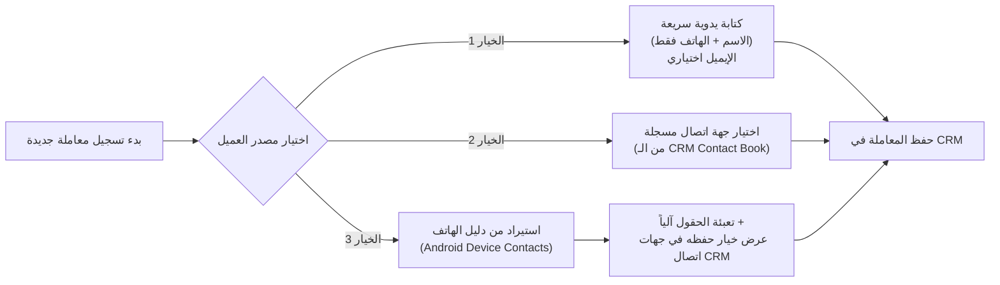

# ELFAZNI SERVICES — Android Mobile Architecture & MDA Blueprint
## وثيقة التصميم الهيكلي ونموذج البيانات الشامل (Model-Driven Architecture - MDA)
**الإصدار:** 1.0 (Production-Ready)  
**تاريخ الإعداد:** 12 نوفمبر 2026  
**الهدف:** تزويد مهندسي البرمجيات وأدوات الذكاء الاصطناعي (AI Coding Assistants / Android Studio) بمخطط هندسي متكامل لبناء تطبيق Android أصيل (Native Android App - Jetpack Compose & Kotlin) يتفاعل بنسبة 100% وبشكل لحظي (Real-Time) مع خادم وقاعدة بيانات منصة **ELFAZNI SERVICES**.

---

## 1. المعمارية العامة ومبدأ العمل اللحظي (System Overview & Real-Time Sync)

```mermaid
flowchart TD
    subgraph Android["📱 Native Android App (Kotlin + Compose)"]
        UI["Jetpack Compose UI\n(Material 3 Luxury Blue & Gold)"]
        VM["MVI ViewModels\n(StateFlow & SharedFlow)"]
        Repo["Data Repositories & Offline Cache\n(Room DB + Datastore)"]
        SSEListener["OkHttp Real-Time SSE Listener\n(EventSource Client)"]
        ContactManager["Device Contacts Picker\n(Android ContactsContract API)"]
        NotificationMgr["Notification & WorkManager\n(FCM + AlarmManager)"]
    end

    subgraph Backend["🌐 ELFAZNI SERVICES Platform (Node.js + Express)"]
        SSEStream["/api/realtime/stream\n(Server-Sent Events)"]
        RestAPI["REST API Endpoints\n(/api/crm, /api/portal, /api/analytics)"]
        AuthGuards["JWT Auth & Security Guards\n(Rate-Limiting + Cookie/Bearer)"]
    end

    subgraph Database["💾 Data Stores (JSON + Cloud Sync)"]
        CRMDB[("data/crm.json\n(Clients, Flights, Visas, Invoices)")]
        PortalDB[("data/db.json\n(Analytics, Messages, Chat, Services)")]
        ProdDB[("data/productivity.json\n(Events, Tasks, Reminders, Notes)")]
    end

    UI --> VM
    VM --> Repo
    Repo --> RestAPI
    SSEStream -.->|Real-Time Push\n(Visits, Messages, CRM Changes)| SSEListener
    SSEListener --> Repo
    ContactManager --> UI
    NotificationMgr --> UI
    RestAPI --> AuthGuards
    AuthGuards --> Database
```

---

## 2. خريطة الأقسام والربط بين الكيانات (Entity-Relationship & Transaction Mapping)

### 2.1 مخطط العلاقات (ERD Diagram)



---

## 3. تفاصيل المعاملات والخط الزمني (Transactions & Timeline Lifecycle)

### 3.1 معالجة معاملات القنصلية والتأشيرات (Consulate / Visa Lifecycle)
1. **الخط الزمني (Timeline Stages):**
   * `1_received` (استلام المستندات وتدقيق الجوازات).
   * `2_processing` (تجهيز الملف والترجمة والشهادات البنكية).
   * `3_scheduled` (حجز موعد القنصلية وتأكيد الحضور).
   * `4_done` (صدور التأشيرة وتسليم الجواز أو إغلاق المعاملة).
2. **الحقول المطلوبة (Mandatory Fields):**
   * `clientName` (اسم العميل).
   * `phoneNumber` (رقم الهاتف مع رمز الدولة).
   * `appointmentType` (نوع المعاملة: تأشيرة سياحية، تجارية، دراسية، إلخ).
   * `submissionDate` (تاريخ الموعد).
   * `price` و `currency` (المبلغ الكلي والعملة).
3. **الحقول الاختيارية (Optional Fields):**
   * `contactId` (إذا كان مرتبطاً بجهة اتصال مسجلة).
   * `email` (البريد الإلكتروني - اختياري بالكامل).
   * `notes` (ملاحظات المعاملة).
   * `flagColor` (لون التمييز البصري).

### 3.2 معالجة تذاكر الطيران (Flight Bookings Lifecycle)
1. **الخط الزمني:**
   * حجز مبدئي (Tentative PNR) -> إصدار التذكرة (Ticket Issued) -> سداد التكلفة (Settled) -> تاريخ السفر (Travel Date).
2. **الحساب الآلي للأرباح (Automatic Profit Calculation):**
   $$\text{Net Profit} = \text{Selling Price} - \text{Agency Cost}$$
   $$\text{Remaining Debt} = \text{Selling Price} - \text{Paid Amount}$$

---

## 4. تكامل جهات اتصال الهاتف المحمول (Android Contacts Picker Integration)

يتيح التطبيق 3 طرق مرنة لإنشاء أي معاملة دون إجبار المستخدم على إدخال بيانات غير ضرورية:



### كود Kotlin النموذجي لتشغيل الـ Contact Picker:
```kotlin
// Android Jetpack Compose Contact Picker Contract
val pickContactLauncher = rememberLauncherForActivityResult(
    contract = ActivityResultContracts.PickContact()
) { uri: Uri? ->
    uri?.let { contactUri ->
        val cursor = context.contentResolver.query(
            contactUri,
            arrayOf(
                ContactsContract.Contacts._ID,
                ContactsContract.Contacts.DISPLAY_NAME_PRIMARY,
                ContactsContract.CommonDataKinds.Phone.NUMBER
            ),
            null, null, null
        )
        cursor?.use {
            if (it.moveToFirst()) {
                val name = it.getString(it.getColumnIndexOrThrow(ContactsContract.Contacts.DISPLAY_NAME_PRIMARY))
                val phone = it.getString(it.getColumnIndexOrThrow(ContactsContract.CommonDataKinds.Phone.NUMBER))
                // التعبئة الفورية في حقول المعاملة
                viewModel.onCustomerSelectedFromPhone(name, phone)
            }
        }
    }
}
```

---

## 5. محرك الإحصائيات والرؤى اللحظية (Analytics & Insights Engine)

### 5.1 الفلاتر الزمنية الثلاثية:
* **يومي (Daily):** حركة اليوم اللحظية، وتوزيع الزوار حسب الساعة، والمعاملات المسجلة اليوم.
* **شهري (Monthly):** مقارنة الأداء مع الشهر السابق، الإيرادات والديون، نمو العملاء.
* **سنوي (Yearly):** إجمالي الإيرادات السنوية، مواسم الذروة (حجوزات الصيف والتأشيرات)، تقرير الضرائب.

### 5.2 قائمة المؤشرات والرسوم البيانية (Metric Cards & Charts):

| القسم | المؤشر (Metric) | نوع العرض البصري | السلوك اللحظي (Real-Time) |
| :--- | :--- | :--- | :--- |
| **الزوار المباشرون** | `activeVisitors` | عداد متوهج أخضر (Live Pulse) | يتغير فور دخول أي زائر جديد للموقع عبر SSE |
| **الزيارات الكلية** | `totalVisits` & `uniqueVisitors` | بطاقة رقمية مع نسبة النمو | تتحدث تلقائياً مع كل تصفح |
| **توزيع الدول** | `topCountries` | قائمة مع أعلام الدول + خريطة تفاعلية | تظهر الدول الأكثر طلباً (تركيا، المغرب، الخليج) |
| **الأجهزة المتصلة** | `deviceBreakdown` | مخطط دائري (Donut Chart) | نسبة الهاتف المحمول مقابل أجهزة الكمبيوتر |
| **إيرادات وأرباح CRM** | `totalRevenue` & `netProfit` | رسم بياني مساحي (Area Chart) | تتحدث فور تسجيل حجز طيران أو دفعة |
| **ميزان الديون والتحصيل**| `paidMinor` vs `balanceDueMinor` | شريط تقدم مزدوج (Progress Bar) | مراقبة الديون المستحقة على العملاء |
| **نسبة نجاح التأشيرات** | `consulateResponse Breakdown` | مخطط أعمدة (Bar Chart) | نسبة المقبول / قيد المعالجة / المرفوض |

---

## 6. التقويم التفاعلي والإشعارات الفورية (Interactive Calendar & Push Notifications)

### 6.1 وظائف التقويم (Calendar Features):
* **طريقة العرض:** عرض شهري مع نقاط ملونة تدل على طبيعة الأحداث، وعرض أسبوعي وجدولي (Agenda).
* **الأحداث المجدولة تلقائياً:**
  1. مواعيد القنصلية القادمة (باللون الأزرق الملكي).
  2. تواريخ رحلات الطيران (باللون السماوي/Cyan).
  3. استحقاقات دفع الفواتير والديون (باللون الوردي/Rose).
  4. المهام والتذكيرات المخصصة (باللون الذهبي/Gold).

### 6.2 نظام الإشعارات (Push Notifications):
* **إشعارات محلية (Local Push via AlarmManager):** تذكير العميل والموظف قبل الموعد بـ 24 ساعة ثم قبل الموعد بساعتين حتى لو كان التطبيق مغلقاً.
* **إشعارات فورية من الخادم (Remote SSE / FCM):**
  * تنبيه لحظي عند وصول رسالة حجز جديدة من الموقع (`mailbox:new`).
  * تنبيه لحظي عند بدء محادثة شات حية من زائر جديد (`chat:message`).
  * تنبيه عند سداد فاتورة أو تعديل معاملة.

---

## 7. مواصفات واجهات البرمجة (REST & SSE API Specification)

### 7.1 البث اللحظي (Real-Time Stream):
* **الرابط:** `GET /api/realtime/stream?admin=1`
* **البروتوكول:** Server-Sent Events (SSE)
* **الأحداث الصادرة:**
  * `analytics:visit`: ترسل بيانات الزائر الجديد والعدادات المحدثة.
  * `mailbox:new`: ترسل استمارة الحجز أو الرسالة الجديدة الواردة من الموقع.
  * `chat:message`: رسائل الدردشة اللحظية.
  * `crm:state_changed`: إشعار بتحديث بيانات الـ CRM للمزامنة الفورية.

### 7.2 التوثيق والمصادقة (Authentication):
* **تسجيل الدخول:** `POST /api/auth/login`
  * Body: `{"username": "elfazni.admin", "password": "..."}`
  * Header العائد: `Authorization: Bearer <JWT_TOKEN>` أو Secure Cookie.
* **استرداد بيانات CRM:** `GET /api/crm/state`
* **تحديث بيانات CRM:** `PUT /api/crm/state` (يتضمن فحص الـ checksum والتعديل المتفائل).
* **إدارة الإنتاجية والتقويم:**
  * `GET /api/crm/productivity/state`
  * `POST /api/crm/productivity/events`
  * `POST /api/crm/productivity/tasks`
  * `POST /api/crm/productivity/reminders`
