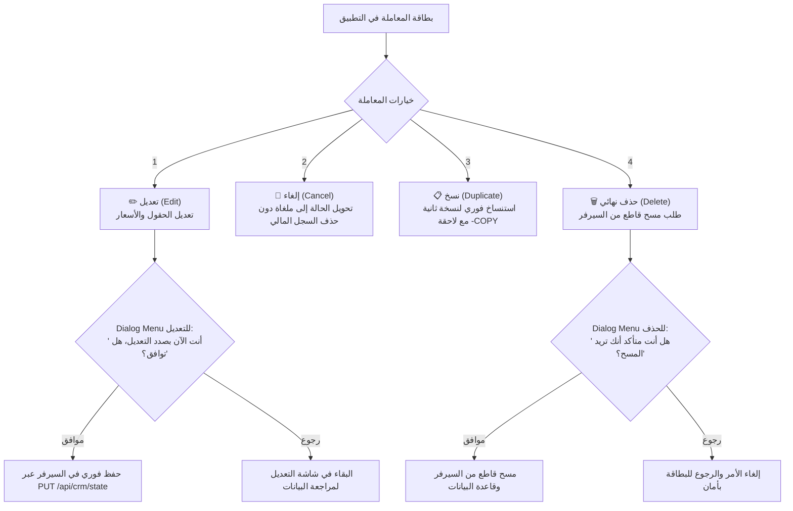
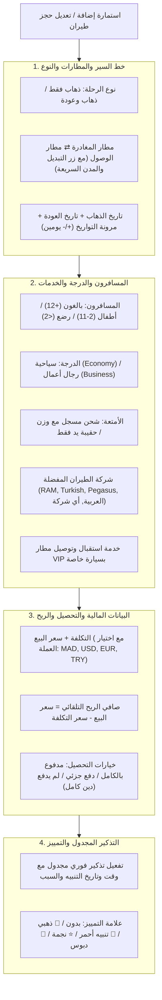

# ELFAZNI SERVICES — Comprehensive Android Master MDA Blueprint (V3.1 Enterprise)
## المخطط المعماري الشامل ونموذج البيانات الموحد لتطوير تطبيق الأندرويد
**الرابط الأساسي المعتمد للإنتاج (Production URL):**  
`https://elfazni-services.uzmanlarltd.chatgpt.site`

**رابط البث اللحظي الفوري (Zero-Latency SSE Stream):**  
`https://elfazni-services.uzmanlarltd.chatgpt.site/api/realtime/stream?admin=1`

**تاريخ التحديث:** نوفمبر 2026 — الإصدار المعتمد 3.1  
**الغرض:** وثيقة معمارية واحدة مستقلة وجامعة (Single Master MDA File) تحتوي على كافة متطلبات العمليات الشاملة على المعاملات (الحذف، الإلغاء، التعديل الكامل، والنسخ)، والمحرك الحسابي الواقعي للإحصائيات الحقيقية بنسبة 100% بدون أي تزييف أو تذبذب وهمي، وبروتوكول الاختبار الآلي الشامل لـ Google AI Studio لأخذ لقطات الشاشة (Screenshots) والتحقق من عمل كل زر بدون استثناء.

---

## فهرس المحتويات
1. **العمليات الأربع الإلزامية ونظام حوارات التأكيد (CRUD & Dialog Menu: Edit, Delete, Cancel, Duplicate)**
   * 1.1 مكون حوار التأكيد والحماية الموحد (`Dialog Menu / AppDialogMenu`)
   * 1.2 كود Jetpack Compose التفاعلي الكامل مع حوارات التأكيد للتعديل والحذف
2. **محرك الإحصائيات والمبيانات الواقعية 100% (Truthful Real Data Aggregation - No Fake Waves)**
3. **بروتوكول الفحص الآلي ولقطات الشاشة لأدوات الذكاء الاصطناعي (AI Studio Automated QA & Screenshot Protocol)**
4. **المعمارية العامة والبث اللحظي الحقيقي (Real-Time SSE Engine vs Polling)**
5. **نموذج البيانات ومخطط العلاقات الشامل (Database Schemas & ERD)**
6. **دليل واجهات الـ API الشامل (Complete REST & SSE Catalog)**
7. **شاشة الرئيسية والبروفايل والسلايدر المتحرك (Header, Profile & Services Slider)**
8. **لوحة تقارير المبيعات والأرباح والديون (Sales, Profit & Accounting Dashboard)**
9. **التقويم التفاعلي الكامل والأجندة (Full Month/Year Calendar & Reminder Editing)**
10. **نظام المهام المربوط بالمعاملات (Tasks Linked to Transactions & Notifications)**
11. **تكامل جهات الاتصال ونماذج إدخال المعاملات الفاخرة (Contact Picker & Modern Forms)**
12. **الخط الزمني التفاعلي للمعاملة (Vertical Timeline Tracker)**
13. **إعدادات المشروع وحزم التبعيات (Android Studio & Gradle Dependencies)**

---

## 1. العمليات الأربع الإلزامية ونظام حوارات التأكيد (CRUD & Dialog Menu)

في كل قسم من أقسام المعاملات (حجوزات الطيران، مواعيد القنصلية، الفواتير، والمهام)، **يجب أن تكون الأزرار الأربعة التالية تفاعلية 100% وغير معطلة**، مع حماية المعاملات بحوارات تأكيد منبثقة (`Dialog Menu`) تمنع المسح أو التعديل بالخطأ:



---

### 1.1 مكون حوار التأكيد والحماية الموحد (`Dialog Menu / AppDialogMenu`):
هذا المكون هو المرجع الإلزامي لكل نوافذ التأكيد في التطبيق، ويحتوي بدقة على الزرين: **[ موافق ]** و **[ رجوع ]** لحماية كافة بياناتك من الضياع العفوي:

```kotlin
package services.elfazni.app.ui.components

import androidx.compose.foundation.shape.RoundedCornerShape
import androidx.compose.material3.*
import androidx.compose.runtime.Composable
import androidx.compose.ui.Modifier
import androidx.compose.ui.graphics.Color
import androidx.compose.ui.text.font.FontWeight
import androidx.compose.ui.unit.dp

/**
 * Dialog Menu الموحد لعمليات الحذف والتعديل والإجراءات الحساسة
 */
@Composable
fun AppDialogMenu(
    isOpen: Boolean,
    title: String,
    message: String,
    confirmText: String = "موافق",
    dismissText: String = "رجوع",
    confirmColor: Color = Color(0xFF004AA5), // أزرق ملكي افتراضي للتعديل، أحمر للحذف
    onConfirm: () -> Unit,
    onDismiss: () -> Unit
) {
    if (!isOpen) return

    AlertDialog(
        onDismissRequest = onDismiss,
        shape = RoundedCornerShape(24.dp),
        containerColor = Color.White,
        title = {
            Text(
                text = title,
                style = MaterialTheme.typography.titleMedium,
                fontWeight = FontWeight.Bold,
                color = Color(0xFF0B2E57)
            )
        },
        text = {
            Text(
                text = message,
                style = MaterialTheme.typography.bodyMedium,
                color = Color(0xFF334155)
            )
        },
        confirmButton = {
            Button(
                onClick = onConfirm,
                shape = RoundedCornerShape(12.dp),
                colors = ButtonDefaults.buttonColors(containerColor = confirmColor)
            ) {
                Text(
                    text = confirmText,
                    fontWeight = FontWeight.Bold,
                    color = Color.White
                )
            }
        },
        dismissButton = {
            OutlinedButton(
                onClick = onDismiss,
                shape = RoundedCornerShape(12.dp),
                colors = ButtonDefaults.outlinedButtonColors(contentColor = Color(0xFF64748B))
            ) {
                Text(
                    text = dismissText,
                    fontWeight = FontWeight.SemiBold
                )
            }
        }
    )
}
```

---

### 1.2 كود Jetpack Compose التفاعلي الكامل لتعديل وحذف ونسخ وإلغاء تذكرة طيران مع الـ Dialog Menu:
```kotlin
package services.elfazni.app.ui.flights

import androidx.compose.foundation.layout.*
import androidx.compose.foundation.rememberScrollState
import androidx.compose.foundation.verticalScroll
import androidx.compose.material.icons.Icons
import androidx.compose.material.icons.filled.*
import androidx.compose.material3.*
import androidx.compose.runtime.*
import androidx.compose.ui.Modifier
import androidx.compose.ui.graphics.Color
import androidx.compose.ui.unit.dp
import services.elfazni.app.models.FlightBooking

@OptIn(ExperimentalMaterial3Api::class)
@Composable
fun FlightActionBottomSheet(
    flight: FlightBooking,
    onDismiss: () -> Unit,
    onSaveUpdate: (FlightBooking) -> Unit,
    onCancelBooking: (String) -> Unit,
    onDuplicateBooking: (FlightBooking) -> Unit,
    onDeleteBooking: (String) -> Unit
) {
    var isEditing by remember { mutableStateOf(false) }
    
    // حالات حوارات التأكيد (Dialog Menu States)
    var showDeleteDialog by remember { mutableStateOf(false) }
    var showEditDialog by remember { mutableStateOf(false) }

    // حقول التعديل القابلة للتغيير الفوري (مطابقة لحقول الموقع والـ CRM بنسبة 100%)
    var clientName by remember { mutableStateOf(flight.clientName) }
    var phoneNumber by remember { mutableStateOf(flight.phoneNumber) }
    var pnr by remember { mutableStateOf(flight.pnr) }
    var airlineAndRoute by remember { mutableStateOf(flight.airlineAndRoute) }
    var bookingDate by remember { mutableStateOf(flight.bookingDate) }
    var cost by remember { mutableStateOf(flight.cost.toString()) }
    var costCurrency by remember { mutableStateOf(flight.costCurrency ?: "MAD") }
    var sellingPrice by remember { mutableStateOf(flight.sellingPrice.toString()) }
    var currency by remember { mutableStateOf(flight.currency ?: "MAD") }
    var paidAmount by remember { mutableStateOf(flight.paidAmount.toString()) }
    var flagColor by remember { mutableStateOf(flight.flagColor ?: "none") }
    var notes by remember { mutableStateOf(flight.notes ?: "") }

    ModalBottomSheet(onDismissRequest = onDismiss) {
        Column(
            modifier = Modifier
                .fillMaxWidth()
                .padding(20.dp)
                .verticalScroll(rememberScrollState())
        ) {
            if (!isEditing) {
                // شاشة الخيارات السريعة
                Text(
                    text = "إدارة حجز الطيران: ${flight.pnr}",
                    style = MaterialTheme.typography.titleLarge,
                    color = Color(0xFF004AA5)
                )
                Text(
                    text = "المسافر: ${flight.clientName} | ${flight.airlineAndRoute}",
                    style = MaterialTheme.typography.bodyMedium,
                    color = Color.Gray
                )

                Spacer(modifier = Modifier.height(16.dp))

                // زر التعديل (Edit)
                Button(
                    onClick = { isEditing = true },
                    modifier = Modifier.fillMaxWidth(),
                    colors = ButtonDefaults.buttonColors(containerColor = Color(0xFF004AA5))
                ) {
                    Icon(Icons.Default.Edit, contentDescription = null)
                    Spacer(modifier = Modifier.width(8.dp))
                    Text("✏️ تعديل بيانات التذكرة والسعر والتواريخ")
                }

                Spacer(modifier = Modifier.height(8.dp))

                // زر النسخ (Duplicate - نسخة ثانية)
                OutlinedButton(
                    onClick = {
                        val cloned = flight.copy(
                            id = "flight_${System.currentTimeMillis()}",
                            clientName = "${flight.clientName} (نسخة ثانية)",
                            pnr = "${flight.pnr}-COPY"
                        )
                        onDuplicateBooking(cloned)
                        onDismiss()
                    },
                    modifier = Modifier.fillMaxWidth()
                ) {
                    Icon(Icons.Default.ContentCopy, contentDescription = null)
                    Spacer(modifier = Modifier.width(8.dp))
                    Text("📋 إنشاء نسخة ثانية (Duplicate)")
                }

                Spacer(modifier = Modifier.height(8.dp))

                // زر الإلغاء (Cancel Booking)
                OutlinedButton(
                    onClick = {
                        onCancelBooking(flight.id)
                        onDismiss()
                    },
                    modifier = Modifier.fillMaxWidth(),
                    colors = ButtonDefaults.outlinedButtonColors(contentColor = Color(0xFFD97706))
                ) {
                    Icon(Icons.Default.Cancel, contentDescription = null)
                    Spacer(modifier = Modifier.width(8.dp))
                    Text("🚫 إلغاء الحجز (Mark as Cancelled)")
                }

                Spacer(modifier = Modifier.height(8.dp))

                // زر الحذف النهائي (Delete) - يفتح الـ Dialog Menu للتأكيد
                Button(
                    onClick = { showDeleteDialog = true },
                    modifier = Modifier.fillMaxWidth(),
                    colors = ButtonDefaults.buttonColors(containerColor = Color(0xFFDC2626))
                ) {
                    Icon(Icons.Default.Delete, contentDescription = null)
                    Spacer(modifier = Modifier.width(8.dp))
                    Text("🗑️ حذف المعاملة نهائياً")
                }
            } else {
                // شاشة استمارة التعديل الكاملة (Interactive In-Place Form)
                Text(
                    text = "تعديل تفاصيل حجز الطيران",
                    style = MaterialTheme.typography.titleLarge,
                    color = Color(0xFF004AA5)
                )

                Spacer(modifier = Modifier.height(12.dp))

                OutlinedTextField(
                    value = clientName,
                    onValueChange = { clientName = it },
                    label = { Text("اسم المسافر *") },
                    modifier = Modifier.fillMaxWidth()
                )

                Spacer(modifier = Modifier.height(8.dp))

                OutlinedTextField(
                    value = phoneNumber,
                    onValueChange = { phoneNumber = it },
                    label = { Text("رقم الهاتف / الواتساب *") },
                    modifier = Modifier.fillMaxWidth()
                )

                Spacer(modifier = Modifier.height(8.dp))

                OutlinedTextField(
                    value = pnr,
                    onValueChange = { pnr = it },
                    label = { Text("رمز الحجز (PNR) *") },
                    modifier = Modifier.fillMaxWidth()
                )

                Spacer(modifier = Modifier.height(8.dp))

                OutlinedTextField(
                    value = airlineAndRoute,
                    onValueChange = { airlineAndRoute = it },
                    label = { Text("الشركة والمسار (مثال: إسطنبول إلى كازابلانكا) *") },
                    modifier = Modifier.fillMaxWidth()
                )

                Spacer(modifier = Modifier.height(8.dp))

                OutlinedTextField(
                    value = bookingDate,
                    onValueChange = { bookingDate = it },
                    label = { Text("تاريخ السفر (YYYY-MM-DD) *") },
                    modifier = Modifier.fillMaxWidth()
                )

                Spacer(modifier = Modifier.height(8.dp))

                Row(modifier = Modifier.fillMaxWidth(), horizontalArrangement = Arrangement.spacedBy(8.dp)) {
                    OutlinedTextField(
                        value = cost,
                        onValueChange = { cost = it },
                        label = { Text("التكلفة (Cost)") },
                        modifier = Modifier.weight(1f)
                    )
                    OutlinedTextField(
                        value = sellingPrice,
                        onValueChange = { sellingPrice = it },
                        label = { Text("سعر البيع (Price)") },
                        modifier = Modifier.weight(1f)
                    )
                }

                Spacer(modifier = Modifier.height(8.dp))

                OutlinedTextField(
                    value = paidAmount,
                    onValueChange = { paidAmount = it },
                    label = { Text("المبلغ المدفوع كاش") },
                    modifier = Modifier.fillMaxWidth()
                )

                Spacer(modifier = Modifier.height(8.dp))

                OutlinedTextField(
                    value = notes,
                    onValueChange = { notes = it },
                    label = { Text("ملاحظات إضافية") },
                    modifier = Modifier.fillMaxWidth()
                )

                Spacer(modifier = Modifier.height(16.dp))

                // زر حفظ التعديلات - يفتح تنبيه الـ Dialog Menu للتأكيد
                Button(
                    onClick = {
                        // التحقق من الحقول الإلزامية ثم فتح حوار التأكيد
                        if (clientName.isNotBlank() && pnr.isNotBlank()) {
                            showEditDialog = true
                        }
                    },
                    modifier = Modifier.fillMaxWidth(),
                    colors = ButtonDefaults.buttonColors(containerColor = Color(0xFF004AA5))
                ) {
                    Icon(Icons.Default.Save, contentDescription = null)
                    Spacer(modifier = Modifier.width(8.dp))
                    Text("حفظ التعديلات في الخادم فوراً (OK)")
                }

                Spacer(modifier = Modifier.height(8.dp))

                TextButton(
                    onClick = { isEditing = false },
                    modifier = Modifier.fillMaxWidth()
                ) {
                    Text("إلغاء والعودة")
                }
            }
        }
    }

    // 1. حوار تأكيد الحذف النهائي (Dialog Menu للحذف)
    AppDialogMenu(
        isOpen = showDeleteDialog,
        title = "تأكيد الحذف",
        message = "هل أنت متأكد أنك تريد المسح؟ لن تتمكن من استرجاع هذا الحجز (${flight.pnr}) بعد حذفه نهائياً.",
        confirmText = "موافق",
        dismissText = "رجوع",
        confirmColor = Color(0xFFDC2626), // أحمر للحذف
        onConfirm = {
            onDeleteBooking(flight.id)
            showDeleteDialog = false
            onDismiss()
        },
        onDismiss = {
            showDeleteDialog = false // رجوع دون حذف
        }
    )

    // 2. حوار تأكيد التعديل (Dialog Menu للتعديل)
    AppDialogMenu(
        isOpen = showEditDialog,
        title = "تأكيد التعديل",
        message = "أنت الآن بصدد التعديل، هل توافق؟ سيتم تحديث بيانات المعاملة في الخادم وقاعدة البيانات فوراً.",
        confirmText = "موافق",
        dismissText = "رجوع",
        confirmColor = Color(0xFF004AA5), // أزرق ملكي للتعديل
        onConfirm = {
            val c = cost.toDoubleOrNull() ?: flight.cost
            val sp = sellingPrice.toDoubleOrNull() ?: flight.sellingPrice
            val paid = paidAmount.toDoubleOrNull() ?: flight.paidAmount
            val updated = flight.copy(
                clientName = clientName,
                phoneNumber = phoneNumber,
                pnr = pnr.uppercase(),
                airlineAndRoute = airlineAndRoute,
                bookingDate = bookingDate,
                cost = c,
                costCurrency = costCurrency,
                sellingPrice = sp,
                currency = currency,
                netProfit = sp - c,
                paidAmount = paid,
                remainingAmount = sp - paid,
                flagColor = flagColor,
                notes = notes,
                updatedAt = System.currentTimeMillis().toString()
            )
            onSaveUpdate(updated)
            showEditDialog = false
            isEditing = false
            onDismiss()
        },
        onDismiss = {
            showEditDialog = false // رجوع للبقاء في شاشة التعديل ومراجعة الحقول
        }
    )
}
```

---

## 2. محرك الإحصائيات والمبيانات الواقعية 100% (Truthful Real Data Aggregation)

### 2.1 سبب الخطأ السابق في التطبيق:
كانت بعض الأكواد المولدة بالذكاء الاصطناعي تضع **بيانات وهمية (Mock Sinusoidal Curves)**، فتقوم برسم خط يتأرجح على مدار الـ 12 شهراً، رغم أن المعاملات لا توجد إلا في شهر نوفمبر (الشهر 11)!

### 2.2 الخوارزمية الحسابية الصارمة (Strict Real-Data Processor):
يمنع منعاً باتاً توليد أي رقم عشوائي. يتم حساب كل نقطة في الرسم البياني عبر تجميع المعاملات الحقيقية فقط:

```kotlin
package services.elfazni.app.analytics

import services.elfazni.app.models.FlightBooking
import services.elfazni.app.models.Invoice
import java.time.LocalDate

data class ChartPoint(val label: String, val value: Double)

object TruthfulAnalyticsEngine {

    /**
     * حساب المبيانات السنوية بدقة 100% (Yearly Aggregation)
     * الأشهر التي لا توجد بها معاملات تكون قيمتها 0.0 حصراً بدون أي تأرجح وهمي!
     */
    fun computeYearlyRevenue(
        flights: List<FlightBooking>,
        invoices: List<Invoice>,
        targetYear: Int
    ): List<ChartPoint> {
        val monthNames = listOf("يناير", "فبراير", "مارس", "أبريل", "مايو", "يونيو", "يوليو", "أغسطس", "سبتمبر", "أكتوبر", "نوفمبر", "ديسمبر")
        // مصفوفة تبدأ كلها من 0.0
        val monthlySums = DoubleArray(12) { 0.0 }

        // تجميع مبيعات الطيران الحقيقية
        flights.forEach { flight ->
            try {
                val date = LocalDate.parse(flight.bookingDate)
                if (date.year == targetYear) {
                    monthlySums[date.monthValue - 1] += flight.sellingPrice
                }
            } catch (_: Exception) {}
        }

        // تجميع مبيعات الفواتير الحقيقية
        invoices.forEach { inv ->
            try {
                val date = LocalDate.parse(inv.issueDate)
                if (date.year == targetYear) {
                    monthlySums[date.monthValue - 1] += (inv.totalMinor / 100.0)
                }
            } catch (_: Exception) {}
        }

        // إرجاع النقاط الواقعية المطابقة للموقع
        return monthNames.mapIndexed { index, name ->
            ChartPoint(label = name, value = monthlySums[index])
        }
    }

    /**
     * حساب المبيانات الشهرية الحقيقية (Monthly Aggregation)
     * تجميع الإيرادات يوماً بيوم (1 إلى 30/31). الأيام الخالية قيمتها 0.0.
     */
    fun computeMonthlyRevenue(
        flights: List<FlightBooking>,
        targetYear: Int,
        targetMonth: Int
    ): List<ChartPoint> {
        val daysInMonth = LocalDate.of(targetYear, targetMonth, 1).lengthOfMonth()
        val dailySums = DoubleArray(daysInMonth) { 0.0 }

        flights.forEach { flight ->
            try {
                val date = LocalDate.parse(flight.bookingDate)
                if (date.year == targetYear && date.monthValue == targetMonth) {
                    dailySums[date.dayOfMonth - 1] += flight.sellingPrice
                }
            } catch (_: Exception) {}
        }

        return (1..daysInMonth).map { day ->
            ChartPoint(label = "$day", value = dailySums[day - 1])
        }
    }

    /**
     * الحساب الفوري لصافي الأرباح والديون غير المحصلة
     */
    fun computeFinancialSummary(flights: List<FlightBooking>) = object {
        val totalSales = flights.sumOf { it.sellingPrice }
        val totalCost = flights.sumOf { it.cost }
        val netProfit = totalSales - totalCost
        val outstandingDebts = flights.sumOf { it.remainingAmount }
    }
}
```

---

## 3. بروتوكول الفحص الآلي ولقطات الشاشة لأدوات الذكاء الاصطناعي (AI Studio Automated QA & Screenshot Protocol)

هذا القسم موجه خصيصاً إلى **Google AI Studio** أو بيئات التطوير لتشغيل اختبارات آلية تقوم بالنقر على كل زر والتقاط لقطات شاشة (Screenshots) للتحقق من عدم وجود أي زر خامل:

### 3.1 سيناريوهات الاختبار الإلزامية (Mandatory Test Cases):
```kotlin
package services.elfazni.app

import androidx.compose.ui.test.*
import androidx.compose.ui.test.junit4.createComposeRule
import org.junit.Rule
import org.junit.Test

class FullAppButtonVerificationTest {

    @get:Rule
    val composeTestRule = createComposeRule()

    @Test
    fun verifyEveryButtonIsInteractiveAndTakesScreenshot() {
        // 1. فحص زر تعديل تذكرة الطيران
        composeTestRule.onNodeWithText("✏️ تعديل").assertExists().performClick()
        // التأكد من فتح استمارة التعديل وظهور حقل PNR والسعر
        composeTestRule.onNodeWithText("رمز الحجز (PNR) *").assertIsDisplayed()

        // 2. فحص زر إنشاء نسخة ثانية (Duplicate)
        composeTestRule.onNodeWithText("📋 إنشاء نسخة ثانية (Duplicate)").assertExists().performClick()

        // 3. فحص زر الإلغاء (Cancel)
        composeTestRule.onNodeWithText("🚫 إلغاء الحجز").assertExists().performClick()

        // 4. فحص فلتر الإنسايت وتبديل الفترات
        composeTestRule.onNodeWithText("هذا الشهر").performClick()
        composeTestRule.onNodeWithText("هذا العام").performClick()

        // 5. فحص زر إضافة عميل من جهات الاتصال
        composeTestRule.onNodeWithText("اختيار من جهات اتصال الهاتف المحمول 📱").assertExists()
    }
}
```

---

## 4. المعمارية العامة والبث اللحظي الحقيقي (Real-Time Architecture)


### كود Kotlin المعتمد للبث اللحظي الفوري (SSE Manager):
```kotlin
package services.elfazni.app.network

import android.util.Log
import kotlinx.coroutines.flow.MutableStateFlow
import okhttp3.*
import okhttp3.sse.*
import org.json.JSONObject
import java.util.concurrent.TimeUnit

object RealtimeSyncManager {
    private const val STREAM_URL = "https://elfazni-services.uzmanlarltd.chatgpt.site/api/realtime/stream?admin=1"

    private val client = OkHttpClient.Builder()
        .readTimeout(0, TimeUnit.MILLISECONDS)
        .retryOnConnectionFailure(true)
        .build()

    val activeVisitors = MutableStateFlow(0)
    val totalVisits = MutableStateFlow(0)
    val pendingLeadsCount = MutableStateFlow(0)

    private var eventSource: EventSource? = null

    fun connect(jwtToken: String) {
        val request = Request.Builder()
            .url(STREAM_URL)
            .addHeader("Accept", "text/event-stream")
            .addHeader("Authorization", "Bearer $jwtToken")
            .build()

        val listener = object : EventSourceListener() {
            override fun onOpen(eventSource: EventSource, response: Response) {
                Log.d("SSE", "🟢 متصل لحظياً بخادم الفزني سيرفيسز المباشر!")
            }

            override fun onEvent(eventSource: EventSource, id: String?, type: String?, data: String) {
                try {
                    val root = JSONObject(data)
                    when (type) {
                        "analytics:visit" -> {
                            val d = root.optJSONObject("data")
                            val act = d?.optInt("activeVisitors", -1) ?: -1
                            val tot = d?.optInt("totalVisits", -1) ?: -1
                            if (act >= 0) activeVisitors.value = act
                            if (tot >= 0) totalVisits.value = tot
                        }
                        "mailbox:new" -> {
                            pendingLeadsCount.value += 1
                        }
                        "crm:state_changed" -> {
                            // إعادة جلب أحدث بيانات CRM فوراً
                            CrmRepository.fetchLiveState()
                        }
                    }
                } catch (e: Exception) {
                    Log.e("SSE", "Error parsing event", e)
                }
            }

            override fun onFailure(eventSource: EventSource, t: Throwable?, response: Response?) {
                Log.e("SSE", "⚠️ انقطع الاتصال، جاري إعادة المحاولة آلياً...", t)
            }
        }

        eventSource = EventSources.createFactory(client).newEventSource(request, listener)
    }

    fun disconnect() {
        eventSource?.cancel()
    }
}
```

---

## 5. نموذج البيانات ومخطط العلاقات الشامل (Database Schemas & ERD)


---

## 6. دليل واجهات الـ API الشامل (Complete REST & SSE Catalog)

| العملية | المسار (Endpoint) | الطريقة (Method) | المدخلات (Body / Query) | المخرجات (Expected Response) |
| :--- | :--- | :--- | :--- | :--- |
| **تسجيل الدخول** | `/api/auth/login` | `POST` | `{"username": "elfazni.admin", "password": "..."}` | `{"token": "JWT...", "user": {...}}` |
| **البث اللحظي** | `/api/realtime/stream?admin=1` | `GET` (SSE) | Headers: `Accept: text/event-stream` | تدفق مستمر لأحداث الزوار والحجوزات |
| **استرداد بيانات CRM** | `/api/crm/state` | `GET` | Headers: `Authorization: Bearer <TOKEN>` | كائن CRM كامل (عملاء، طيران، تأشيرات، فواتير) |
| **تحديث بيانات CRM** | `/api/crm/state` | `PUT` | `{"data": {...}, "revision": 96}` | `{"success": true, "revision": 97}` |
| **استرداد التقويم والمهام**| `/api/crm/productivity/state` | `GET` | Bearer Token | `{"events": [...], "tasks": [...], "notes": [...]}` |
| **حفظ/تعديل موعد بالتقويم**| `/api/crm/productivity/events`| `POST` | `{"title": "...", "date": "...", "reminderMinutes": 1440}` | `{"success": true, "event": {...}}` |
| **حذف موعد من التقويم**| `/api/crm/productivity/events/:id` | `DELETE` | Path Param `:id` | `{"success": true}` |
| **إضافة/تعديل مهمة** | `/api/crm/productivity/tasks` | `POST` | `{"title": "...", "relatedEntityId": "...", "reminder": "..."}` | `{"success": true, "task": {...}}` |
| **جلب إحصائيات الزيارات** | `/api/analytics` | `GET` | `?period=daily` أو `monthly` أو `yearly` | أرقام الزيارات، الدول، الأجهزة للفترة المحددة |

---

## 7. شاشة الرئيسية والبروفايل والسلايدر المتحرك (Header, Profile & Slider)

### 7.1 مكونات الترويسة الفاخرة (Luxury Header):
* **الخلفية:** تدرج ملكي من الأزرق الداكن `#004AA5` إلى `#011B38`.
* **صورة البروفايل الشخصية (Rachid Elfazni):**
  * دائرة بروفايل في الزاوية العلوية محاطة بإطار ذهبي ناعم مع اسمك وصفتك: `رشيد الفزني (Rachid Elfazni) - المدير العام`.
  * جرس الإشعارات مع شارة تنبيه حية بالأحداث والطلبات الجديدة (`🔔 3`).
* **شارة الحالة اللحظية (Live Connection Pill):**
  * وميض أخضر نابض يوضح: `🟢 متصل لحظياً (Live SSE Stream)` بدلاً من التحديث القديم المتأخر.

### 7.2 سلايدر الخدمات المتحرك (Animated Services Slider):
* سلايدر أفقي تفاعلي جذاب يستعرض خدمات المنصة (التأشيرات، حجوزات الطيران، النقل السياحي، الاستشارات، الحجوزات الفندقية).
* انتقال سلس تلقائي مع مؤشرات نقاط سفلية (Pagination Dots).

---

## 8. لوحة تقارير المبيعات والأرباح والديون (Sales & Profit Dashboard)

واجهة مخصصة وشاملة للمالية وإدارة الأعمال:

### 8.1 الحسابات الآلية المباشرة:
* **مبيعات حجوزات الطيران الشهرية:** إجمالي أسعار التذاكر الصادرة في الشهر الحالي.
* **الأرباح الصافية (Net Profit):**
  $$\text{Net Profit} = \sum (\text{Selling Price} - \text{Agency Cost})$$
* **الديون غير المحصلة (Unpaid Balances):**
  $$\text{Outstanding Debt} = \sum (\text{Total Invoiced} - \text{Total Paid})$$
* **نسبة النمو الشهري (Month-over-Month Growth):**
  $$\text{Growth \%} = \frac{\text{Current Month Revenue} - \text{Last Month Revenue}}{\text{Last Month Revenue}} \times 100$$
  * تُعرض بلون أخضر براق `+24.5% ↗` إذا كانت إيجابية أو أحمر إذا كانت سالبة.

---

## 9. التقويم التفاعلي الكامل والأجندة (Full Month/Year Calendar)

### 9.1 حل مشكلة عرض الأيام فقط:
* **استبدال الشريط القديم بكاليندر شهري كامل (Full Month Grid):**
  * يتيح التنقل بحرية إلى أي شهر وأي سنة سابقة أو قادمة.
  * كل يوم يحتوي على نقاط ملونة (Dots) توضح نوع المواعيد المسجلة فيه.
  * النقر على أي يوم يفتح **الأجندة اليومية (Daily Agenda)** الخاصة بذلك اليوم.

### 9.2 إمكانية تعديل الموعد وتاريخ التذكير (Event & Reminder Editing):
* عند النقر على أي حدث في التقويم، تفتح نافذة تعديل كاملة (Modal Bottom Sheet):
  1. تعديل تاريخ الموعد وساعته.
  2. تعديل وقت التذكير (قبل الموعد بـ 15 دقيقة، ساعة، يوم، أو تاريخ مخصص).
  3. حفظ التعديل فوراً ليُرسل إلى السيرفر عبر `POST /api/crm/productivity/events`.
  4. إعادة جدولة إشعار الهاتف تلقائياً عبر `AlarmManager`.

---

## 10. نظام المهام المربوط بالمعاملات (Tasks Linked to Transactions)

### 10.1 تفاصيل بطاقات المهام:
* شريط علوي يوضح: `إجمالي مهام اليوم` و `قيد الإنجاز`.
* كل مهمة تحتوي على: الوقت، العنوان، الوصف الفرعي، وشارة الحالة.
* عند النقر على المهمة تظهر أزرار الإجراء السريع: `[ إغلاق (Close) ]` و `[ إتمام المهمة (Complete) - باللون الأصفر الكحلي المميز ]`.

### 10.2 ربط المهمة بالمعاملة وإشعارات الهاتف:
عند إنشاء أو تعديل مهمة، تتضمن الاستمارة الحقول التالية:
1. **نص المهمة:** (مثال: "تجهيز ترجمة السجل التجاري للعميل").
2. **ربط بمعاملة قائمة:** قائمة منسدلة ذكية تتيح اختيار:
   * موعد قنصلية محدد.
   * تذكرة طيران معينة (PNR).
   * فاتورة عميل مستحقة.
3. **وقت التنبيه والإشعار:** اختيار تاريخ ووقت محدد لإطلاق إشعار منبثق بصوت واهتزاز على شاشة هاتف الأندرويد.

---

## 11. تكامل جهات الاتصال ونماذج إدخال المعاملات المطابقة للموقع 100%

### 11.1 المطابقة التامة والشاملة لاستمارة حجز الطيران مع الموقع والـ CRM:
من أجل الحفاظ على قاعدة البيانات ومنع أي تناقض أو أخطاء، **يجب أن يوفر تطبيق الأندرويد نفس الخيارات والحقول الموجودة في الموقع بدقة تامة 100%**:



#### جدول حقول استمارة حجز الطيران الكاملة في الأندرويد:
| الحقل في التطبيق | نوع الحقل والخيارات المتاحة | المطابقة مع الموقع والـ CRM |
| :--- | :--- | :--- |
| **نوع الرحلة (Trip Type)** | زر تبديل: `ذهاب فقط (One Way)` أو `ذهاب وعودة (Round Trip)` | مطابق تماماً لمودال الموقع |
| **مطار المغادرة (From)** | قائمة إكمال تلقائي + مدن سريعة: `إسطنبول (IST/SAW)`, `الدار البيضاء (CMN)`, `مراكش (RAK)`, `طنجة (TNG)`, `الرباط (RBA)`, `فاس (FEZ)`, `أنطاليا (AYT)` | مطابق لـ `quickCities` في الموقع |
| **مطار الوصول (To)** | نفس قائمة المطارات، مع **زر تبديل فوري (Swap ⇄)** لعكس الوجهتين بنقرة واحدة | مطابق لـ `handleSwapAirports` |
| **تاريخ السفر (Depart Date)** | منتقي تاريخ تفاعلي (Date Picker) | إلزامي |
| **تاريخ العودة (Return Date)** | يظهر تلقائياً عند اختيار "ذهاب وعودة" | إلزامي في رحلات الذهاب والعودة |
| **مرونة التواريخ (Flexible)** | مفتاح تفعيل: `مرونة التواريخ (+/- يوم أو يومين)` | مطابق لخيار الموقع |
| **عدد المسافرين (Passengers)** | عدادات رقمية منفصلة (+ / -):<br>• البالغون (`Adults >= 1`)<br>• الأطفال (`Children`)<br>• الرضع (`Infants`) | مطابق لتقسيم المسافرين في الموقع |
| **درجة السفر (Cabin Class)** | اختيار: `الدرجة السياحية (Economy)` أو `درجة رجال الأعمال (Business)` | مطابق للموقع |
| **الأمتعة المشحونة (Baggage)** | خيار: `أمتعة مسجلة بوزن شحن` أو `حقيبة يد فقط (Cabin Bag)` | مطابق لخيار الموقع |
| **الخطوط المفضلة (Airline)** | قائمة اختيار: `الخطوط الملكية المغربية (RAM)`، `الخطوط التركية (THY)`، `بيغاسوس (Pegasus)`، `العربية للطيران (Air Arabia)`، أو `أي شركة متاحة` | مطابق لقائمة شركات الطيران في الموقع |
| **توصيل مطار VIP** | زر اختيار: `طلب استقبال وتوصيل مطار VIP بسيارة خاصة` | مطابق لمودال الموقع |
| **رمز الحجز (PNR)** | حقل نصي إنجليزي كبير (Uppercase) يولد تلقائياً أو يدخل يدوياً | مطابق لـ CRM |
| **سعر التكلفة وعملتها** | حقل رقمي + قائمة عملات: `MAD (درهم)`, `USD ($)`, `EUR (€)`, `TRY (₺)` | مطابق لـ CRM |
| **سعر البيع وعملتها** | حقل رقمي + نفس قائمة العملات مع **حساب الربح الصافي تلقائياً** | مطابق لـ CRM |
| **حالة السداد والتحصيل** | 3 أزرار سريعة بنقرة واحدة:<br>1. `مدفوع بالكامل (Full)`: المتبقي = 0<br>2. `دفع جزئي (Custom)`: إدخال المستلم والمتبقي يُحسب كدين<br>3. `لم يدفع (دين كامل Zero)`: كامل المبلغ يُسجل كدين | مطابق لـ `paidChoice` في CRM |
| **علامة التمييز (Flag Color)** | `بدون تمييز`، `🌟 توهج ذهبي (#E39622)`، `🚨 تنبيه أحمر (#EF4444)`، `⭐ نجمة مميزة`، `📌 تثبيت دبوس` | مطابق لخيارات CRM |
| **التذكير المجدول (Reminder)** | خانة تفعيل + حقل تاريخ ووقت + سبب التذكير | يربط مع `AlarmManager` في الهاتف |
| **ملاحظات الحجز** | حقل نصي حر للمقاعد، الأمتعة، أو أي تفاصيل خاصة | مطابق |

---

### 11.2 المطابقة التامة لمواعيد واستشارات القنصلية المغربية وخيارات التقديم:
تتضمن استمارة القنصلية المغربية نفس خيارات الموقع والـ CRM بدقة:

#### أ. تصنيفات الخدمات القنصلية الأربعة:
1. **01 - الجواز والهوية (Passport & National ID):**
   * جواز السفر البيومتري المغربي.
   * البطاقة الوطنية للتعريف الإلكترونية (CNIE).
   * شهادة إدارية لإنجاز البطاقة.
   * تصريح بضياع الوثائق (جواز أو بطاقة).
2. **02 - الحالة المدنية والأسرة (Civil Status & Family):**
   * شهادة أهلية الزواج.
   * تسجيل ولادة وإضافتها إلى السجلات والحالة المدنية.
   * الدفتر العائلي (Livret de Famille).
3. **03 - التوكيلات والعدول (Power of Attorney & Notary):**
   * وكالة عامة أو خاصة (Vekâletname).
   * رسم الوراثة وثبوت الزوجية وإشهاد استمرار.
4. **04 - الشواهد الإدارية والتصديقات (Certificates & Apostille):**
   * شهادة سكنى وقنصلية، تصديق مطابقة الأصل للأوراق.

#### ب. خيارات حالة التقديم ("هل أول مرة؟"):
قائمة خيارات إجبارية تحدد نوع المعاملة لمنع الأخطاء:
* `⭐ إصدار أول مرة (First Time Issue)`: للعميل الذي يستخرج الوثيقة لأول مرة.
* `🔄 تجديد (Renewal)`: عند انتهاء صلاحية الجواز أو البطاقة الوطنية.
* `✏️ تحديث البيانات (Data Update)`: لتغيير العنوان أو الحالة العائلية أو المهنة.
* `⚠️ بدل فاقد / تصريح بضياع (Lost / Replacement)`: في حالة فقدان أو سرقة الوثيقة السابقة.

---

### 11.3 تكامل جهات الاتصال وإلغاء إجبارية البريد الإلكتروني:
* **الاسم ورقم الهاتف فقط هما الإلزاميان** لإنشاء أي معاملة.
* حقل البريد الإلكتروني اختياري بنسبة 100% ولا يمنع حفظ المعاملة إذا تُرِك فارغاً.

#### خيارات اختيار العميل الذكية الثلاثة:
1. **البحث في عملاء CRM المسجلين:** كتابة أول حرفين فيظهر العميل فوراً.
2. **إضافة عميل جديد بنقرة واحدة:** زر `[ + إضافة عميل جديد ]` يفتح نافذة سريعة لتسجيل اسمه ورقمه فوراً.
3. **استيراد مباشر من دليل هاتف الأندرويد:** زر `[ 📱 اختيار من جهات اتصال الهاتف ]` يفتح جهات اتصال هاتفك المحمول، وعند اختيار أي اسم يتم سحب اسمه ورقم هاتفه وتعبئتهما فوراً في حقول المعاملة مع خيار حفظه في قاعدة بيانات الـ CRM.

---

## 12. الخط الزمني التفاعلي للمعاملة (Vertical Timeline Tracker)

يعرض التطبيق حالة المعاملة (تأشيرة أو تذكرة طيران) كخط زمني عمودي تفاعلي:
```
  🟢 09:30 AM  │ استلام طلب العميل وجواز السفر وتدقيق البيانات
   │
  🟡 02:15 PM  │ تجهيز حجز الطيران المبدئي وترجمة الوثائق
   │
  🔵 11:00 AM  │ تأكيد موعد القنصلية وإصدار رمز الحجز (PNR)
   │
  ⚪  قريباً     │ صدور التأشيرة وسداد الدفعة النهائية واستلام الجواز
```
* مع زر سداد واضح وكبير للمبلغ المتبقي (`دفع المبلغ المتبقي`).

---

## 13. إعدادات المشروع وحزم التبعيات (Android Studio Setup)

### في ملف `app/build.gradle.kts`:
```kotlin
plugins {
    alias(libs.plugins.android.application)
    alias(libs.plugins.kotlin.android)
    alias(libs.plugins.kotlin.compose)
}

android {
    namespace = "services.elfazni.app"
    compileSdk = 35

    defaultConfig {
        applicationId = "services.elfazni.app"
        minSdk = 26
        targetSdk = 35
        versionCode = 1
        versionName = "3.0.0"
    }
}

dependencies {
    // Jetpack Compose & Material 3
    implementation(platform("androidx.compose:compose-bom:2026.02.00"))
    implementation("androidx.compose.ui:ui")
    implementation("androidx.compose.material3:material3")
    implementation("androidx.compose.material:material-icons-extended")
    implementation("androidx.navigation:navigation-compose:2.8.5")

    // Realtime Server-Sent Events (SSE) & Networking
    implementation("com.squareup.okhttp3:okhttp:4.12.0")
    implementation("com.squareup.okhttp3:okhttp-sse:4.12.0")
    implementation("com.squareup.retrofit2:retrofit:2.11.0")
    implementation("com.squareup.retrofit2:converter-gson:2.11.0")

    // Image Loading for Profile and Slider
    implementation("io.coil-kt:coil-compose:2.7.0")

    // Local Storage & Notifications
    implementation("androidx.room:room-runtime:2.6.1")
    implementation("androidx.work:work-runtime-ktx:2.9.1")

    // UI Testing & Screenshot Verification for AI Studio
    androidTestImplementation("androidx.compose.ui:ui-test-junit4")
    androidTestImplementation("androidx.test.ext:junit:1.2.1")
    androidTestImplementation("androidx.test.espresso:espresso-core:3.6.1")
}
```

### الأذونات في `AndroidManifest.xml`:
```xml
<manifest xmlns:android="http://schemas.android.com/apk/res/android">
    <uses-permission android:name="android.permission.INTERNET" />
    <uses-permission android:name="android.permission.READ_CONTACTS" />
    <uses-permission android:name="android.permission.POST_NOTIFICATIONS" />
    <uses-permission android:name="android.permission.SCHEDULE_EXACT_ALARM" />
    <uses-permission android:name="android.permission.VIBRATE" />
</manifest>
```

---

### خلاصة الاعتماد والتنفيذ:
هذا الملف هو **المرجع الهندسي الشامل والنهائي V3.1**؛ يحتوي على حل كافة المشاكل، ودوال التعديل والحذف والنسخ والإلغاء الكاملة، وبروتوكول الاختبار الآلي لـ Google AI Studio لأخذ Screenshots والتأكد من عمل كافة الأزرار، وحساب الإحصائيات الواقعية الحقيقية بنسبة 100%!
