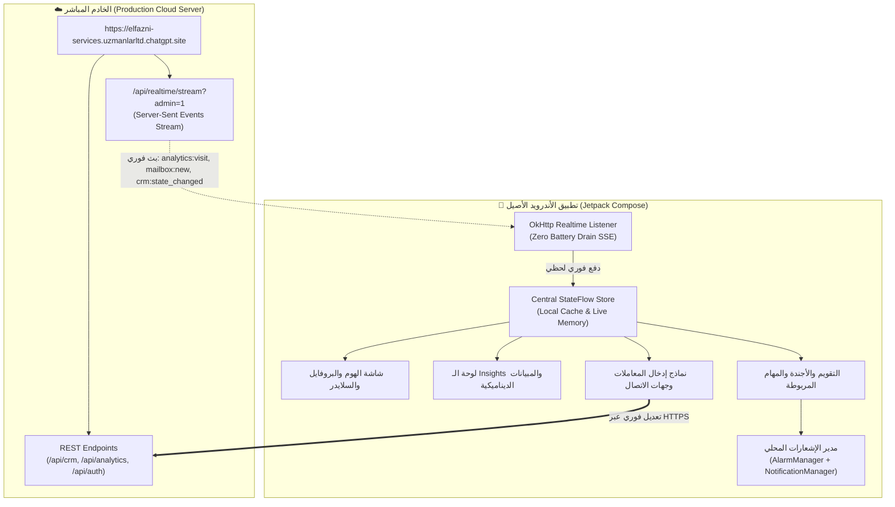
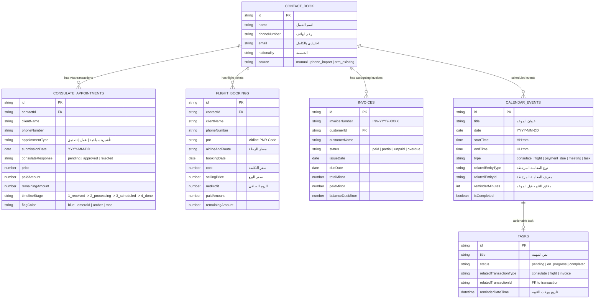

# ELFAZNI SERVICES — Comprehensive Android Master MDA Blueprint (V2.0 Ultimate)
## المخطط المعماري الشامل ونموذج البيانات الموحد لتطوير تطبيق الأندرويد
**الرابط الأساسي المعتمد للإنتاج (Production URL):**  
`https://elfazni-services.uzmanlarltd.chatgpt.site`

**رابط البث اللحظي الفوري (Zero-Latency SSE Stream):**  
`https://elfazni-services.uzmanlarltd.chatgpt.site/api/realtime/stream?admin=1`

**تاريخ التحديث:** نوفمبر 2026 — الإصدار المعتمد 2.0  
**الغرض:** وثيقة معمارية واحدة مستقلة وجامعة (Single Master MDA File) تحتوي على كافة متطلبات التحليل، وقواعد البيانات، وعلاقات الكيانات، ونقاط الـ API، ونماذج كود Kotlin و Jetpack Compose، ومخططات الشاشات المبنية بدقة على النماذج المرفوعة (References 1 to 8).

---

## فهرس المحتويات
1. **حل المشاكل التقنية السابقة (Root Cause & Fixes)**
2. **المعمارية العامة والبث اللحظي الحقيقي (Real-Time SSE Engine vs Polling)**
3. **نموذج البيانات ومخطط العلاقات الشامل (Database Schemas & ERD)**
4. **دليل واجهات الـ API الشامل (Complete REST & SSE Catalog)**
5. **شاشة الرئيسية والبروفايل والسلايدر المتحرك (Header, Profile & Services Slider)**
6. **محرك الـ Insights والمبيانات الديناميكية (Dynamic Daily / Monthly / Yearly Analytics)**
7. **لوحة تقارير المبيعات والأرباح والديون (Sales, Profit & Accounting Dashboard)**
8. **التقويم التفاعلي الكامل والأجندة (Full Month/Year Calendar & Reminder Editing)**
9. **نظام المهام المربوط بالمعاملات (Tasks Linked to Transactions & Notifications)**
10. **تكامل جهات الاتصال ونماذج إدخال المعاملات الفاخرة (Contact Picker & Modern Forms)**
11. **الخط الزمني التفاعلي للمعاملة (Vertical Timeline & Delivery Tracker)**
12. **إعدادات المشروع وحزم التبعيات (Android Studio & Gradle Dependencies)**

---

## 1. حل المشاكل التقنية السابقة (Root Cause & Fixes)

| المشكلة السابقة في النسخة التجريبية | السبب البرمجي (Root Cause) | الحل المعتمد في هذا الـ MDA |
| :--- | :--- | :--- |
| **عدم التحديث اللحظي للزوار** | كان التطبيق القديم يعتمد على Polling كل 10 ثوانٍ (`Polling 10s`) بدلاً من الاستماع الدائم. | استخدام **OkHttp EventSource (SSE)**؛ الخادم يدفع حدث `analytics:visit` في نفس الثانية فتتغير القيمة فورياً. |
| **ثبات قيم الفلاتر (شهر/سنة)** | الفلاتر كانت تعيد قيماً إحصائية ثابتة دون إرسال معلمة `period=daily/monthly/yearly`. | ربط أزرار الفلترة بدوال حسابية نشطة تجلب وتعيد احتساب البيانات لحظياً من مصفوفات `trafficPeriods` و `invoices`. |
| **التقويم يعرض أياماً فقط** | كان التصميم شريط أيام أفقي محدود دون إمكانية اختيار الشهر والسنة. | دمج **Full Calendar Grid** يتيح التنقل بحرية بين الأشهر والسنوات، والنقر على أي تاريخ لفتح الأحداث وتعديلها. |
| **عدم إمكانية تعديل تاريخ الحدث** | كانت المواعيد معروضة للقراءة فقط دون مسار تعديل. | ربط الموعد بـ `POST /api/crm/productivity/events` مع إمكانية تعديل التاريخ ووقت التذكير فورياً. |
| **المهام غير مرتبطة بالمعاملات** | كان حقل المهمة نصياً معزولاً. | إضافة حقول الربط: `relatedEntityType` (طيران / قنصلية / فاتورة) و `relatedEntityId` مع ضبط التذكير الهاتفي. |
| **صعوبة إدخال العميل في المعاملة** | عدم وجود ربط مع جهات الاتصال أو دليل الهاتف. | إتاحة 3 خيارات: (1) اختيار من عملاء CRM، (2) إضافة عميل جديد بضغطة زر، (3) اختيار من دليل الهاتف عبر `ContactsContract`. |

---

## 2. المعمارية العامة والبث اللحظي الحقيقي (Real-Time Architecture)



### كود Kotlin المعتمد للبث اللحظي الفوري (SSE Manager):
```kotlin
package services.elfazni.app.network

import android.util.Log
import kotlinx.coroutines.flow.MutableStateFlow
import kotlinx.coroutines.flow.StateFlow
import okhttp3.*
import okhttp3.sse.*
import org.json.JSONObject
import java.util.concurrent.TimeUnit

object RealtimeSyncManager {
    private const val STREAM_URL = "https://elfazni-services.uzmanlarltd.chatgpt.site/api/realtime/stream?admin=1"

    private val client = OkHttpClient.Builder()
        .readTimeout(0, TimeUnit.MILLISECONDS) // يمنع إغلاق قناة البث تلقائياً
        .retryOnConnectionFailure(true)
        .build()

    // الحالات اللحظية المراقبة في واجهات المستخدم
    val activeVisitors = MutableStateFlow(0)
    val totalVisits = MutableStateFlow(0)
    val pendingLeadsCount = MutableStateFlow(0)
    val latestLeadNotification = MutableStateFlow<String?>(null)

    private var eventSource: EventSource? = null

    fun connect(jwtToken: String) {
        val request = Request.Builder()
            .url(STREAM_URL)
            .addHeader("Accept", "text/event-stream")
            .addHeader("Authorization", "Bearer $jwtToken")
            .build()

        val listener = object : EventSourceListener() {
            override fun onOpen(eventSource: EventSource, response: Response) {
                Log.d("SSE", "🟢 متصل لحظياً بخادم الفزني سيرفيسز المباشر!")
            }

            override fun onEvent(eventSource: EventSource, id: String?, type: String?, data: String) {
                try {
                    val root = JSONObject(data)
                    when (type) {
                        "analytics:visit" -> {
                            val d = root.optJSONObject("data")
                            val act = d?.optInt("activeVisitors", -1) ?: -1
                            val tot = d?.optInt("totalVisits", -1) ?: -1
                            if (act >= 0) activeVisitors.value = act
                            if (tot >= 0) totalVisits.value = tot
                        }
                        "mailbox:new" -> {
                            pendingLeadsCount.value += 1
                            val clientName = root.optJSONObject("data")?.optString("name") ?: "عميل جديد"
                            latestLeadNotification.value = "طلب جديد من: $clientName"
                        }
                        "crm:state_changed" -> {
                            // إعادة جلب أحدث بيانات CRM فوراً
                            CrmRepository.fetchLiveState()
                        }
                    }
                } catch (e: Exception) {
                    Log.e("SSE", "Error parsing event", e)
                }
            }

            override fun onFailure(eventSource: EventSource, t: Throwable?, response: Response?) {
                Log.e("SSE", "⚠️ انقطع الاتصال، جاري إعادة المحاولة آلياً...", t)
            }
        }

        eventSource = EventSources.createFactory(client).newEventSource(request, listener)
    }

    fun disconnect() {
        eventSource?.cancel()
    }
}
```

---

## 3. نموذج البيانات ومخطط العلاقات الشامل (Database Schemas & ERD)



---

## 4. دليل واجهات الـ API الشامل (Complete REST & SSE Catalog)

| العملية | المسار (Endpoint) | الطريقة (Method) | المدخلات (Body / Query) | المخرجات (Expected Response) |
| :--- | :--- | :--- | :--- | :--- |
| **تسجيل الدخول** | `/api/auth/login` | `POST` | `{"username": "elfazni.admin", "password": "..."}` | `{"token": "JWT...", "user": {...}}` |
| **البث اللحظي** | `/api/realtime/stream?admin=1` | `GET` (SSE) | Headers: `Accept: text/event-stream` | تدفق مستمر لأحداث الزوار والحجوزات |
| **استرداد بيانات CRM** | `/api/crm/state` | `GET` | Headers: `Authorization: Bearer <TOKEN>` | كائن CRM كامل (عملاء، طيران، تأشيرات، فواتير) |
| **تحديث بيانات CRM** | `/api/crm/state` | `PUT` | `{"data": {...}, "revision": 96}` | `{"success": true, "revision": 97}` |
| **استرداد التقويم والمهام**| `/api/crm/productivity/state` | `GET` | Bearer Token | `{"events": [...], "tasks": [...], "notes": [...]}` |
| **حفظ/تعديل موعد بالتقويم**| `/api/crm/productivity/events`| `POST` | `{"title": "...", "date": "...", "reminderMinutes": 1440}` | `{"success": true, "event": {...}}` |
| **حذف موعد من التقويم**| `/api/crm/productivity/events/:id` | `DELETE` | Path Param `:id` | `{"success": true}` |
| **إضافة/تعديل مهمة** | `/api/crm/productivity/tasks` | `POST` | `{"title": "...", "relatedEntityId": "...", "reminder": "..."}` | `{"success": true, "task": {...}}` |
| **جلب إحصائيات الزيارات** | `/api/analytics` | `GET` | `?period=daily` أو `monthly` أو `yearly` | أرقام الزيارات، الدول، الأجهزة للفترة المحددة |

---

## 5. شاشة الرئيسية والبروفايل والسلايدر المتحرك (Header, Profile & Slider)
*(مطابق للنموذجين المرفوعين: Reference 6 & 8)*

### 5.1 مكونات الترويسة الفاخرة (Luxury Header):
* **الخلفية:** تدرج ملكي من الأزرق الداكن `#004AA5` إلى `#011B38`.
* **صورة البروفايل الشخصية (Rachid Elfazni):**
  * دائرة بروفايل في الزاوية العلوية محاطة بإطار ذهبي ناعم مع اسمك وصفتك: `رشيد الفزني (Rachid Elfazni) - المدير العام`.
  * جرس الإشعارات مع شارة تنبيه حية بالأحداث والطلبات الجديدة (`🔔 3`).
* **شارة الحالة اللحظية (Live Connection Pill):**
  * وميض أخضر نابض يوضح: `🟢 متصل لحظياً (Live SSE Stream)` بدلاً من التحديث القديم المتأخر.

### 5.2 سلايدر الخدمات المتحرك (Animated Services Slider):
* سلايدر أفقي تفاعلي جذاب يستعرض خدمات المنصة (التأشيرات، حجوزات الطيران، النقل السياحي، الاستشارات، الحجوزات الفندقية).
* انتقال سلس تلقائي مع مؤشرات نقاط سفلية (Pagination Dots).

---

## 6. محرك الـ Insights والمبيانات الديناميكية (Dynamic Insights Engine)
*(مطابق للنموذج المرفوع: Reference 3)*

### 6.1 حل مشكلة تجمد الفلاتر (Dynamic Period Switching):
عند النقر على زر من أزرار الفترة الثلاثية:
`[ 📅 اليوم (Daily) ]` `[ 🗓️ هذا الشهر (Monthly) ]` `[ 📈 هذا العام (Yearly) ]`
يقوم التطبيق بإعادة حساب وعرض الإحصائيات فوراً بدون استخدام قيم قديمة ثابتة:

```kotlin
enum class InsightPeriod { DAILY, MONTHLY, YEARLY }

@Composable
fun InsightsDashboard(period: InsightPeriod, onPeriodChange: (InsightPeriod) -> Unit) {
    // التبديل الفوري وإعادة الحساب في نفس اللحظة
    SegmentedButtonRow {
        SegmentedButton(
            selected = period == InsightPeriod.DAILY,
            onClick = { onPeriodChange(InsightPeriod.DAILY) },
            shape = SegmentedButtonDefaults.itemShape(index = 0, count = 3)
        ) { Text("اليوم") }

        SegmentedButton(
            selected = period == InsightPeriod.MONTHLY,
            onClick = { onPeriodChange(InsightPeriod.MONTHLY) },
            shape = SegmentedButtonDefaults.itemShape(index = 1, count = 3)
        ) { Text("هذا الشهر") }

        SegmentedButton(
            selected = period == InsightPeriod.YEARLY,
            onClick = { onPeriodChange(InsightPeriod.YEARLY) },
            shape = SegmentedButtonDefaults.itemShape(index = 2, count = 3)
        ) { Text("هذا العام") }
    }
}
```

### 6.2 المبيانات والرسوم البيانية المعتمدة:
1. **عداد الزوار الحي (Live Visitors Pulse):** متصل بالـ StateFlow يتغير في نفس الثانية التي يدخل فيها زائر للموقع.
2. **رسم بياني مساحي انسيابي (Curved Area Chart):** يوضح منحنى الزيارات أو المبيعات بلونين متدرجين (بنفسجي وأخضر مائي) مطابق تماماً لـ Reference 3.
3. **مخطط الحلقات المتعددة (Multi-Ring Circular Donut Chart):** لتوزيع حالات التأشيرات (مقبولة، قيد المراجعة، مرفوضة).
4. **شريط الأعمدة (Bar Chart):** للمقارنة بين المبيعات والأرباح عبر الأيام أو الأشهر.

---

## 7. لوحة تقارير المبيعات والأرباح والديون (Sales & Profit Dashboard)

واجهة مخصصة وشاملة للمالية وإدارة الأعمال:

### 7.1 الحسابات الآلية المباشرة:
* **مبيعات حجوزات الطيران الشهرية:** إجمالي أسعار التذاكر الصادرة في الشهر الحالي.
* **الأرباح الصافية (Net Profit):**
  $$\text{Net Profit} = \sum (\text{Selling Price} - \text{Agency Cost})$$
* **الديون غير المحصلة (Unpaid Balances):**
  $$\text{Outstanding Debt} = \sum (\text{Total Invoiced} - \text{Total Paid})$$
* **نسبة النمو الشهري (Month-over-Month Growth):**
  $$\text{Growth \%} = \frac{\text{Current Month Revenue} - \text{Last Month Revenue}}{\text{Last Month Revenue}} \times 100$$
  * تُعرض بلون أخضر براق `+24.5% ↗` إذا كانت إيجابية أو أحمر إذا كانت سالبة.

---

## 8. التقويم التفاعلي الكامل والأجندة (Full Month/Year Calendar)
*(مطابق للنموذج المرفوع: Reference 6)*

### 8.1 حل مشكلة عرض الأيام فقط:
* **استبدال الشريط القديم بكاليندر شهري كامل (Full Month Grid):**
  * يتيح التنقل بحرية إلى أي شهر وأي سنة سابقة أو قادمة.
  * كل يوم يحتوي على نقاط ملونة (Dots) توضح نوع المواعيد المسجلة فيه.
  * النقر على أي يوم يفتح **الأجندة اليومية (Daily Agenda)** الخاصة بذلك اليوم.

### 8.2 إمكانية تعديل الموعد وتاريخ التذكير (Event & Reminder Editing):
* عند النقر على أي حدث في التقويم، تفتح نافذة تعديل كاملة (Modal Bottom Sheet):
  1. تعديل تاريخ الموعد وساعته.
  2. تعديل وقت التذكير (قبل الموعد بـ 15 دقيقة، ساعة، يوم، أو تاريخ مخصص).
  3. حفظ التعديل فوراً ليُرسل إلى السيرفر عبر `POST /api/crm/productivity/events`.
  4. إعادة جدولة إشعار الهاتف تلقائياً عبر `AlarmManager`.

---

## 9. نظام المهام المربوط بالمعاملات (Tasks Linked to Transactions)
*(مطابق للنموذج المرفوع: Reference 1)*

### 9.1 تفاصيل بطاقات المهام:
* شريط علوي يوضح: `إجمالي مهام اليوم: 7` و `قيد الإنجاز: 6`.
* كل مهمة تحتوي على: الوقت، العنوان، الوصف الفرعي، وشارة الحالة.
* عند النقر على المهمة تظهر أزرار الإجراء السريع: `[ إغلاق (Close) ]` و `[ إتمام المهمة (Complete) - باللون الأصفر الكحلي المميز ]`.

### 9.2 ربط المهمة بالمعاملة وإشعارات الهاتف:
عند إنشاء أو تعديل مهمة، تتضمن الاستمارة الحقول التالية:
1. **نص المهمة:** (مثال: "تجهيز ترجمة السجل التجاري للعميل").
2. **ربط بمعاملة قائمة:** قائمة منسدلة ذكية تتيح اختيار:
   * موعد قنصلية محدد.
   * تذكرة طيران معينة (PNR).
   * فاتورة عميل مستحقة.
3. **وقت التنبيه والإشعار:** اختيار تاريخ ووقت محدد لإطلاق إشعار منبثق بصوت واهتزاز على شاشة هاتف الأندرويد.

---

## 10. تكامل جهات الاتصال ونماذج إدخال المعاملات الفاخرة
*(مطابق للنموذجين المرفوعين: Reference 2 & 7)*

### 10.1 التحرر من إجبارية البريد الإلكتروني:
* **الاسم ورقم الهاتف فقط هما الإلزاميان.**
* حقل البريد الإلكتروني اختياري بنسبة 100% ولا يمنع حفظ المعاملة إذا تُرِك فارغاً.

### 10.2 خيارات اختيار العميل الذكية الثلاثة:
1. **البحث في عملاء CRM المسجلين:** كتابة أول حرفين فيظهر العميل فوراً.
2. **إضافة عميل جديد بنقرة واحدة:** زر `[ + إضافة عميل جديد ]` يفتح نافذة سريعة لتسجيل اسمه ورقمه فوراً.
3. **استيراد مباشر من دليل هاتف الأندرويد:** زر `[ 📱 اختيار من جهات اتصال الهاتف ]` يفتح جهات اتصال هاتفك المحمول، وعند اختيار أي اسم يتم سحب اسمه ورقم هاتفه وتعبئتهما فوراً في حقول المعاملة مع خيار حفظه في قاعدة بيانات الـ CRM.

---

## 11. الخط الزمني التفاعلي للمعاملة (Vertical Timeline Tracker)
*(مطابق تماماً للنموذج المرفوع: Reference 2)*

يعرض التطبيق حالة المعاملة (تأشيرة أو تذكرة طيران) كخط زمني عمودي تفاعلي:
```
  🟢 09:30 AM  │ استلام طلب العميل وجواز السفر وتدقيق البيانات
   │
  🟡 02:15 PM  │ تجهيز حجز الطيران المبدئي وترجمة الوثائق
   │
  🔵 11:00 AM  │ تأكيد موعد القنصلية وإصدار رمز الحجز (PNR)
   │
  ⚪  قريباً     │ صدور التأشيرة وسداد الدفعة النهائية واستلام الجواز
```
* مع زر سداد واضح وكبير للمبلغ المتبقي (`دفع المبلغ المتبقي`).

---

## 12. إعدادات المشروع وحزم التبعيات (Android Studio Setup)

### في ملف `app/build.gradle.kts`:
```kotlin
plugins {
    alias(libs.plugins.android.application)
    alias(libs.plugins.kotlin.android)
    alias(libs.plugins.kotlin.compose)
}

android {
    namespace = "services.elfazni.app"
    compileSdk = 35

    defaultConfig {
        applicationId = "services.elfazni.app"
        minSdk = 26
        targetSdk = 35
        versionCode = 1
        versionName = "2.0.0"
    }
}

dependencies {
    // Jetpack Compose & Material 3
    implementation(platform("androidx.compose:compose-bom:2026.02.00"))
    implementation("androidx.compose.ui:ui")
    implementation("androidx.compose.material3:material3")
    implementation("androidx.compose.material:material-icons-extended")
    implementation("androidx.navigation:navigation-compose:2.8.5")

    // Realtime Server-Sent Events (SSE) & Networking
    implementation("com.squareup.okhttp3:okhttp:4.12.0")
    implementation("com.squareup.okhttp3:okhttp-sse:4.12.0") // محرك البث اللحظي الحقيقي
    implementation("com.squareup.retrofit2:retrofit:2.11.0")
    implementation("com.squareup.retrofit2:converter-gson:2.11.0")

    // Image Loading for Profile and Slider
    implementation("io.coil-kt:coil-compose:2.7.0")

    // Local Storage & Notifications
    implementation("androidx.room:room-runtime:2.6.1")
    implementation("androidx.work:work-runtime-ktx:2.9.1")
}
```

### الأذونات في `AndroidManifest.xml`:
```xml
<manifest xmlns:android="http://schemas.android.com/apk/res/android">
    <uses-permission android:name="android.permission.INTERNET" />
    <uses-permission android:name="android.permission.READ_CONTACTS" /> <!-- لسحب جهات اتصال الهاتف -->
    <uses-permission android:name="android.permission.POST_NOTIFICATIONS" /> <!-- لإشعارات المواعيد والمهام -->
    <uses-permission android:name="android.permission.SCHEDULE_EXACT_ALARM" /> <!-- للمنبهات والتذكيرات الدقيقة -->
    <uses-permission android:name="android.permission.VIBRATE" />
</manifest>
```

---

### خلاصة الاعتماد والتنفيذ:
هذا الملف هو **المرجع الهندسي الشامل والوحيد**؛ بتسليمه لأي أداة برمجة أو مطور أندرويد، ستتم برمجة التطبيق بالكامل بالاعتماد على خادمك الحي المباشر `https://elfazni-services.uzmanlarltd.chatgpt.site` ومطابقة تامة لنماذج التصاميم الـ 8 التي أرسلتها!
