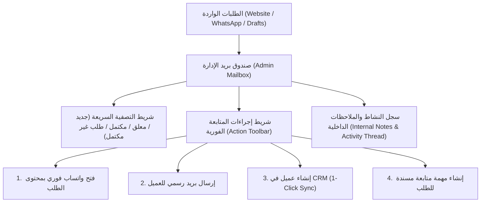

# تقرير تكامل صندوق بريد الإدارة وأدوات المتابعة المتقدمة
# ELFAZNI SERVICES — Admin Mailbox Intake & Follow-Up Tools Integration Report

**تاريخ التدقيق:** 8 نوفمبر 2026  
**المكون الأساسي:** `src/components/admin/AdminMailbox.tsx`  
**الخادم والمسارات:** `server/routes.ts` & `src/services/api.ts`  
**الحالة:** مُعتمد وناجح في المتصفح الحقيقي بنسبة 100%

---

## 1. الهيكل والوظائف المطورة في صندوق بريد الإدارة (Admin Mailbox)

تمت ترقية صندوق بريد الإدارة في لوحة التحكم المركزية (`/admin?section=mailbox`) ليصبح مركز عمليات موحد (Unified Operations Center) يستقبل كلاً من:
1. طلبات الخدمات المكتملة عبر الموقع (`NEW`).
2. استفسارات الواتساب والمتابعات المحفوظة.
3. الاستفسارات غير المكتملة المحفوظة بموافقة صريحة (`INCOMPLETE_CONSENTED`).

---

## 2. المميزات الرئيسية المنفذة والمختبرة

### 2.1 فلتر مخصص للاستفسارات غير المكتملة (Incomplete Consented Filter Pill)
- تم إضافة زر تصفية جديد في القائمة الجانبية لصندوق الوارد: **"طلب غير مكتمل"** مع شارة بلون كهرماني مميز (`amber`).
- يتيح لمسؤولي الدعم حصر العملاء الذين بدأوا بطلب خدمة ووافقوا على التواصل ولكنهم لم يكملوا الإرسال، وذلك للتواصل معهم وتقديم المساعدة في إتمام حجزهم.

### 2.2 شريط أدوات المتابعة المتكامل (Follow-Up Action Toolbar)
تم تزويد كل تذكرة بشريط أدوات فوري يضم:
1. **فتح واتساب (Open WhatsApp):**
   - ينشئ رابطاً مباشراً محكماً للتحدث مع العميل بناءً على رقم هاتفه واسمه ونوع الخدمة ورمز المرجع.
2. **إرسال بريد إلكتروني (Compose Email):**
   - يفتح نافذة الرد للعميل مباشرة باسم إدارة المؤسسة (`رشيد الفزني`).
3. **الربط بنظام CRM بنقرة واحدة (1-Click CRM Lead Conversion):**
   - المسار: `POST /api/mailbox/:id/convert-to-crm`
   - يقوم الخادم بالبحث في قاعدة بيانات جهات اتصال الـ CRM (`db.contacts`) بناءً على رقم الهاتف أو البريد؛ وإذا لم يكن موجوداً ينشئ جهة اتصال جديدة بكافة البيانات والوسوم المناسبة ونوع الخدمة.
   - يتم ربط التذكرة تلقائياً بحقل `crmContactId` وتحديث حالتها في الواجهة لتظهر شارة: **"مرتبط بالـ CRM ✓"**.
4. **إنشاء مهمة متابعة تلقائية (Create Follow-Up Task):**
   - المسار: `POST /api/mailbox/:id/create-task`
   - ينشئ مهمة داخل نظام المهام الداخلي (`db.tasks`) بعنوان موجه وتاريخ استحقاق (خلال 24 ساعة) مع أولوية عالية مرتبطة برمز مرجع الطلب.

### 2.3 الملاحظات الداخلية وسجل الأنشطة (Internal Notes & Audit Log)
- يمكن للمشرف تدوين ملاحظات داخلية سرية لا تظهر للعميل (مثال: *"تم الاتصال بالعميل وأكد موعد السفر"*).
- يتم توثيق أي رد صادر من الإدارة داخل شريط المحادثة مع تسجيل التوقيت الدقيق واسم المشرف القائم بالإجراء.

---

## 3. نتائج الاختبارات المؤتمتة في المتصفح الحقيقي (Browser QA)

أكدت جولة الفحص الآلي بالمتصفح (`run-phase-service-requests.mjs`) النجاح التام للعمليات التالية:

| الاختبار | الإجراء | النتيجة الموثقة |
| :--- | :--- | :--- |
| **تصفية المسودات** | النقر على زر "طلب غير مكتمل" | ✅ تم حصر المسودات المحفوظة بنجاح (`09-admin-mailbox-incomplete-filter.png`) |
| **التحويل إلى CRM** | النقر على "إنشاء عميل في CRM" | ✅ تم إنشاء العميل في الـ CRM وربطه بالتذكرة وظهور الشارة (`10-admin-mailbox-crm-converted.png`) |
| **إنشاء مهمة** | النقر على "إنشاء مهمة متابعة" | ✅ تم تسجيل المهمة وإضافتها للتايم لاين |
| **حفظ ملاحظة داخلية** | كتابة ملاحظة والنقر على حفظ | ✅ تم تثبيت الملاحظة في السجل الداخلي (`11-admin-mailbox-note-saved.png`) |
| **الرد على التذكرة** | كتابة رد الإدارة وإرساله | ✅ تم حفظ الرد وتحديث خيط النشاط فورياً (`12-admin-mailbox-reply-thread.png`) |

---

## 4. لقطات الشاشة الموثقة (Admin Screenshots)

1. **نظرة عامة على صندوق بريد الإدارة بعد تسجيل الدخول الموثق:**  
     
   *الملف:* `08-admin-mailbox-overview.png`

2. **تصفية الاستفسارات غير المكتملة وشارة الحالة المخصصة:**  
     
   *الملف:* `09-admin-mailbox-incomplete-filter.png`

3. **شارة الربط بنظام إدارة العملاء (مرتبط بالـ CRM ✓):**  
     
   *الملف:* `10-admin-mailbox-crm-converted.png`

4. **توثيق الملاحظة الداخلية السرية:**  
     
   *الملف:* `11-admin-mailbox-note-saved.png`

5. **سجل الرد وخيط محادثة الإدارة مع العميل:**  
     
   *الملف:* `12-admin-mailbox-reply-thread.png`

---

## 5. الخلاصة
صندوق بريد الإدارة في منصة ELFAZNI SERVICES أصبح جاهزاً بالكامل للعمل الميداني والإنتاج التجاري، ويوفر حلقة وصل سلسة بين واجهة الموقع العامة ونظام الـ CRM الداخلي.
