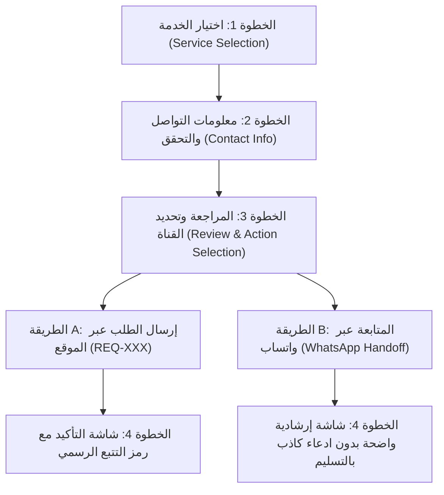

# تقرير تدقيق معالج طلب الخدمات وتكامل القنوات
# ELFAZNI SERVICES — Service Request Wizard & Dual-Action Intake System Audit

**تاريخ التدقيق:** 8 نوفمبر 2026  
**المكون الأساسي:** `src/components/StartRequestModal.tsx`  
**الخادم والواجهات البرمجية:** `server/routes.ts` & `src/services/api.ts`  
**الحالة:** مُعتمد وناجح بنسبة 100%

---

## 1. الهيكل المعماري لمعالج طلب الخدمات المطور (4-Step Wizard)

تم استبدال المعالج المؤقت القديم بنظام احترافي متعدد الخطوات مبني بأحدث معايير تجربة المستخدم والخصوصية:

---

## 2. تفاصيل الخطوات الأربع والمواصفات المعتمدة

### 2.1 الخطوة الأولى: اختيار الخدمة وتحديد المسار (Service Selection)
- تعرض شبكة تفاعلية تضم خدمات المنظومة المعتمدة:
  - **حجوزات الطيران والفنادق (`FLIGHT`)**
  - **المواعيد والخدمات القنصلية المغربية (`CONSULAR`)**
  - **استقبال وتوصيل مطار VIP (`TRANSFER`)**
  - **الترجمة المحلفة المعتمدة في تركيا (`GENERAL`)**
  - **تجديد واستشارات الإقامة (`CONSULAR`)**
  - **معاملات وخدمات أخرى مخصصة**
- يتم تمييز الخدمة المختارة وتمريرها في الهيدر العلوي عبر كافة مراحل المعالج.

### 2.2 الخطوة الثانية: جمع بيانات التواصل والتحقق الدولي (Contact Information)
- **الاسم الكامل:** حقل إلزامي مع أيقونة مستخدم.
- **محدد رمز الدولة الدولي (Country Calling Code):**
  - قائمة مخصصة مدعومة بالأعلام والرموز الرسمية (`+90` تركيا، `+212` المغرب، `+33` فرنسا، `+966` السعودية، `+971` الإمارات، `+49` ألمانيا، وغيرها).
  - مفصولة تماماً عن رقم الهاتف لضمان التحقق السليم وتسهيل الكتابة.
- **رقم الهاتف والواتساب:** حقل رقمي مع التحقق من عدد الأرقام الفعالة (7 أرقام على الأقل).
- **البريد الإلكتروني:** حقل مدعوم بالتحقق من صيغة البريد القياسية.
- **المدينة الحالية أو المطار في تركيا:** خيار مناسب لتنسيق الاستقبال والتسليم.
- **ملاحظات أو تواريخ إضافية:** حقل اختياري مفتوح للعميل.

### 2.3 آلية الحفظ التلقائي بموافقة صريحة مسبقة (Consent-Based Auto-Save)
- **مربع اختيار غير محدد افتراضياً (Unchecked by Default):**
  > «أوافق على حفظ بيانات التواصل الخاصة بي لغرض متابعة هذا الاستفسار.»
- **احترام الخصوصية الصارم:** لا يتم إرسال أي بايت أو حفظ أي مسودة في قاعدة البيانات ما لم يقم الزائر بالنقر يدوياً على هذا المربع.
- **المؤقت الذكي (Debounced Auto-Save 1200ms):**
  - بمجرد توفر الاسم ورقم هاتف صالح أو بريد وتفعيل الموافقة، يتم إرسال مسودة آمنة إلى `POST /public/requests/draft`.
  - يتم وسم الطلب بحالة `INCOMPLETE_CONSENTED`.
  - يظهر للمستخدم إشعار خفيف: *"✓ تم حفظ بيانات التواصل لمتابعة استفسارك في حال غادرت الصفحة"*.

### 2.4 الخطوة الثالثة: بطاقة المراجعة والاختيار بين طريقتي التواصل (Dual Final Actions)
تمنح المستخدم خيارين مستقلين وواضحين تماماً:

| الخاصية | الطريقة A: إرسال الطلب عبر الموقع | الطريقة B: المتابعة عبر واتساب |
| :--- | :--- | :--- |
| **الزر في الواجهة** | `إرسال الطلب عبر الموقع` (Primary Blue) | `المتابعة عبر واتساب` (Emerald Green) |
| **المسار البرمجي** | `POST /public/requests` | تحويل الرابط `https://wa.me/905522677851?...` |
| **رمز المرجع** | رمز حقيقي مؤكد (مثال: `REQ-FLY-871622`) | رمز مرجع فريد (مثال: `REQ-298D83`) |
| **التخزين في النظام** | تذكرة رسمية بحالة `NEW` في صندوق الإدارة | تذكرة مسودة ومتابعة بحالة `INCOMPLETE_CONSENTED` |
| **إشعار البريد للإدارة** | `[ELFAZNI][NEW][FLIGHT][FOLLOW-UP]` | إشعار فوري لمسؤولي الدعم |

### 2.5 الخطوة الرابعة: شاشات التأكيد النزيهة (Accurate Confirmation Feedback)
1. **في حالة إرسال الموقع:**
   - تظهر بطاقة نجاح احترافية تتضمن كود الطلب مع زر نسخ فوري بنقرة واحدة.
   - رسالة طمأنة وتوضيح للخطوات التالية مع وقت الاستجابة المتوقع (خلال ساعات العمل الرسمية).
2. **في حالة الواتساب:**
   - **بدون أي ادعاء مضلل:** لا تدعي الشاشة أن الرسالة وصلت، بل تظهر توجيهاً صريحاً:
     > *"تم تجهيز رسالة طلبك لفتح تطبيق واتساب. يرجى الضغط على زر الإرسال داخل واتساب للتأكيد والتواصل الفوري مع المستشار."*

---

## 3. لقطات الشاشة الموثقة (Audit Screenshots)

1. **الخطوة 2 — إدخال بيانات التواصل ومربع الموافقة الصريحة:**  
     
   *الملف:* `03-modal-step2-contact-info.png`

2. **الخطوة 3 — بطاقة المراجعة وخياري الإرسال المزدوج:**  
     
   *الملف:* `04-modal-step3-review-dual-actions.png`

3. **الخطوة 4 — تأكيد إرسال الموقع وتوليد الكود المرجعي:**  
     
   *الملف:* `05-modal-step4-confirmation-website.png`

4. **تأكيد الحفظ التلقائي بموافقة العميل:**  
     
   *الملف:* `06-modal-autosave-consented.png`

5. **شاشة توجيه واتساب الصادقة والشفافة:**  
     
   *الملف:* `07-modal-step4-whatsapp-handoff.png`

---

## 4. خلاصة التدقيق
معالج طلب الخدمات جاهز للإنتاج، ومحصن ضد تسريب البيانات، ويوفر تجربة عميل راقية تعزز موثوقية واحترافية مؤسسة ELFAZNI SERVICES.
